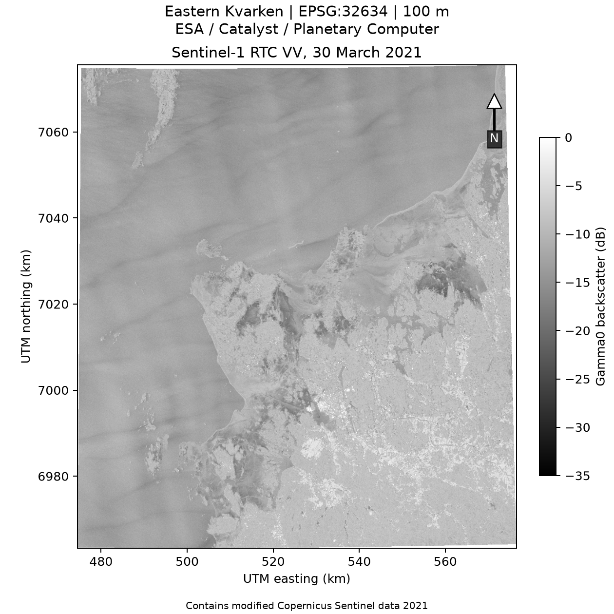
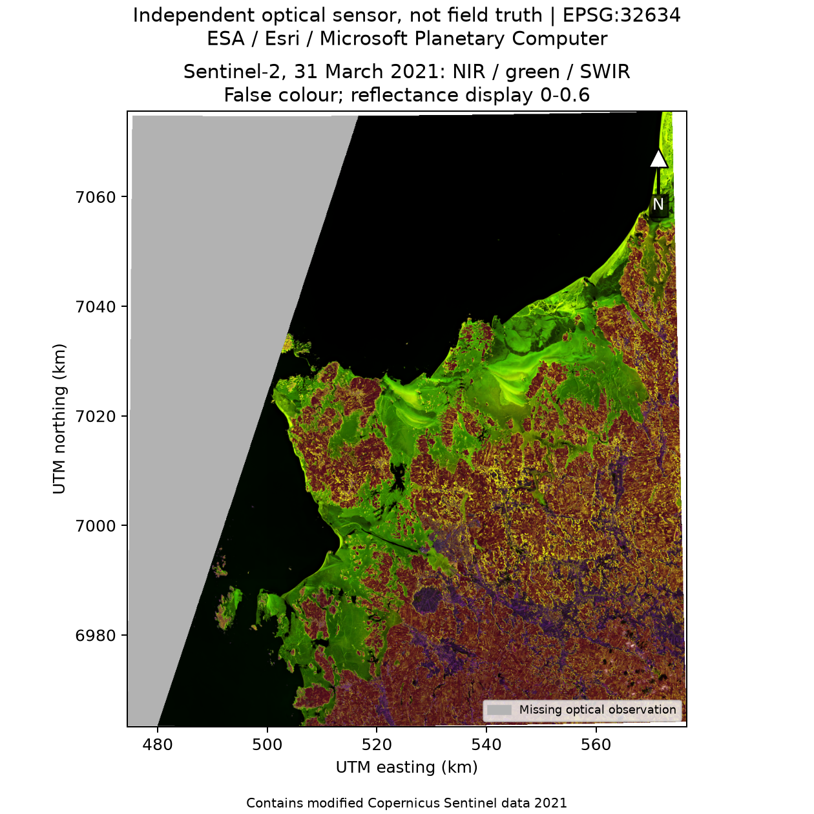
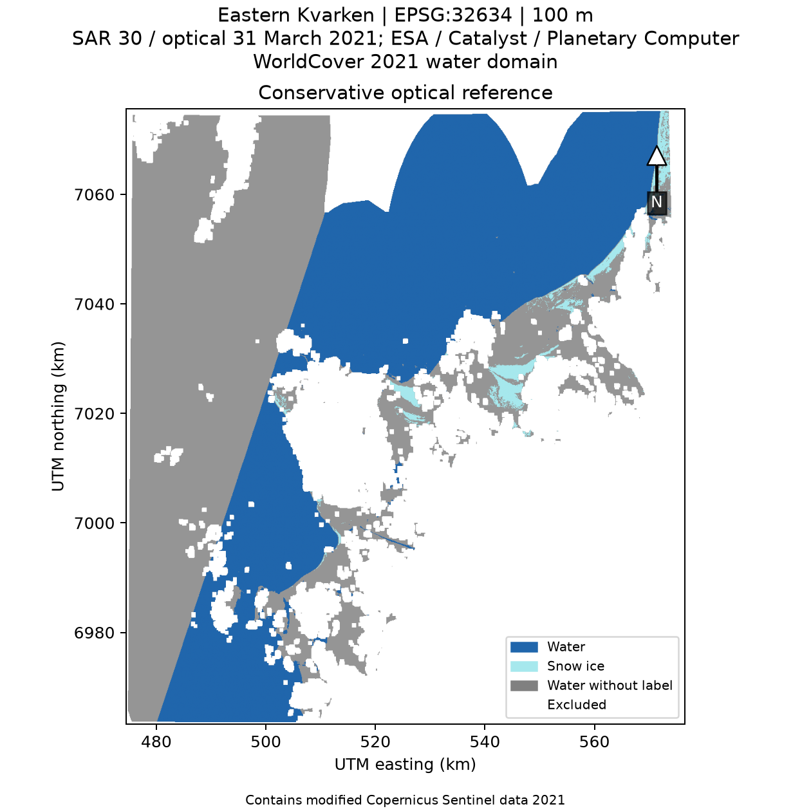
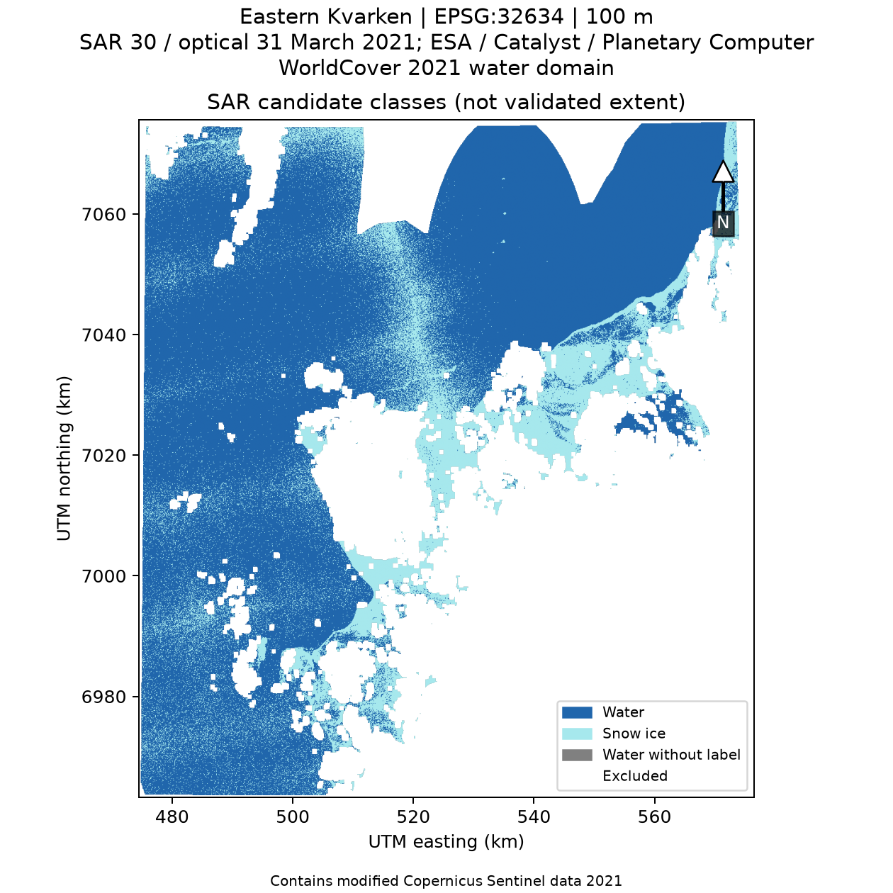
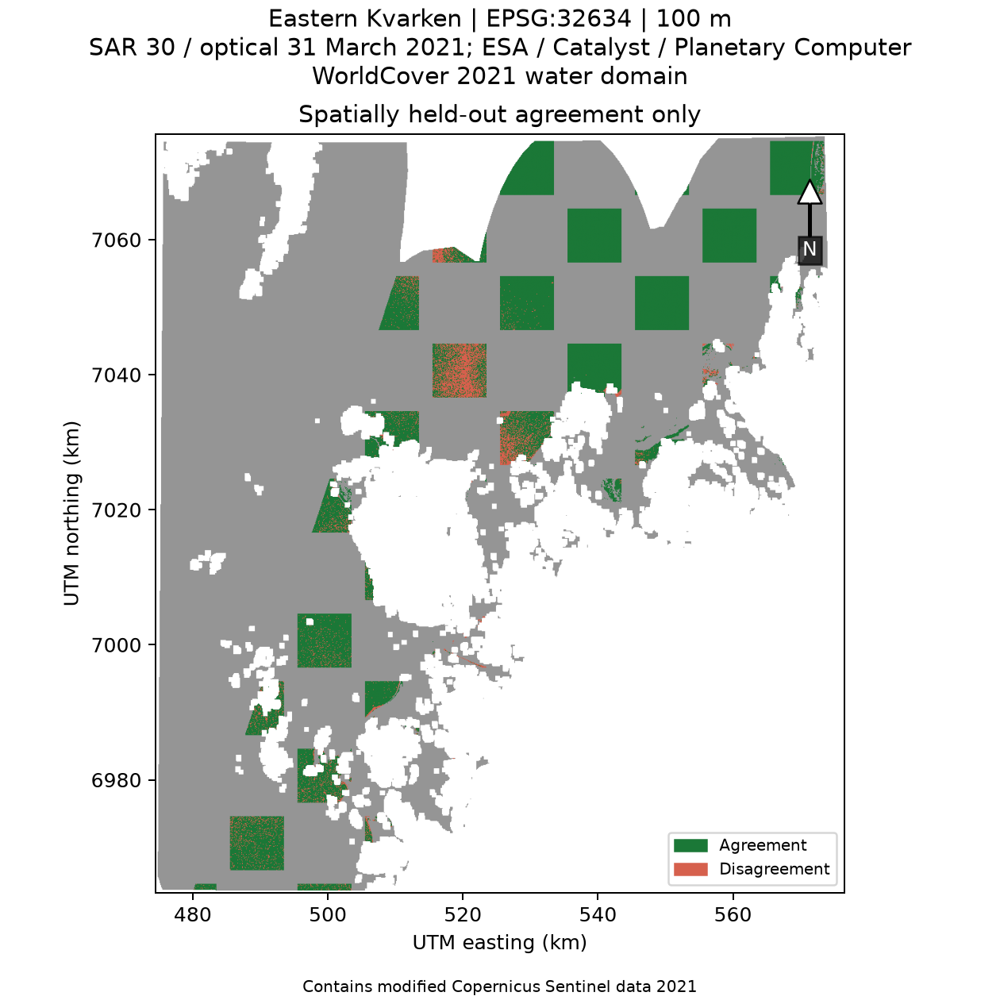
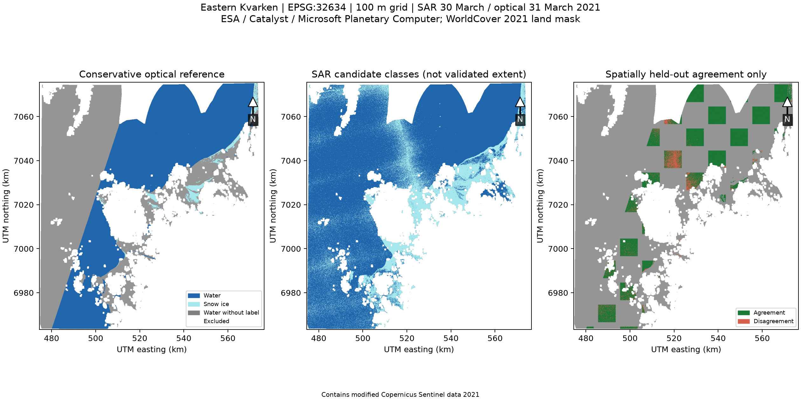

# Kvarken Thesis: Learn the Science and Engineering

## An evidence-grounded textbook from first observations to a reproducible EO system

**Educational derivative, version 1.0 — 26 October 2026**  
**Based on:** *Design and Implementation of a Hybrid Earth Observation Data Infrastructure for Research and Education: A Case Study of Kvarken Space Center*  
**Author of the underlying thesis:** Däniel Ebrahimzadeh Esfahani

> **Document status.** This is a newly assembled educational derivative based on the checked-in thesis manuscript, implementation, and research records. The attachment named `Kvarken_theses_learn.docx` was not present in the worktree available for this task, so its text could not be read or preserved line by line. The existing shared thesis Google Doc is a different document and was not edited. This book does not claim that either source document was updated.

### How evidence is labelled

- **[THESIS FACT]** A claim transcribed from the checked-in thesis, implementation, or dated research artifact.
- **[GENERAL SCIENCE]** Established scientific or technical background, supported by a cited primary or authoritative source.
- **[ILLUSTRATIVE EXAMPLE]** A classroom number or small example invented to teach a method; it is not a thesis observation.
- **[PROPOSED FUTURE WORK]** A recommendation or experiment not yet completed in the thesis.
- **[COURSE MATERIAL]** Reserved for verified course content. No Moodle resource could be inspected for this edition.

Unless a different label appears, equations in worked examples use **illustrative** values. A result is not automatically reliable just because it comes from a computer, a map, or a formula.

## A map of the book

This is an 11-lesson progression. Readers can begin with Lesson 1; each later lesson reuses ideas introduced earlier. The book moves from asking scientific questions, through light and radar, maps, mathematics, code, and data infrastructure, into the actual Kvarken experiment and its reproducibility limits.

| Lesson | Main question |
|---|---|
| 1. How do we know? | What makes a claim scientific and an experiment useful? |
| 2. How does Earth send information to a satellite? | What are light, reflectance, radar, and backscatter? |
| 3. What do satellites observe? | How do Sentinel, orbits, sensors, and Kvarken fit together? |
| 4. Where is a pixel? | How do coordinates, projections, rasters, resolution, and area work? |
| 5. What mathematics reads a pixel? | How do indices, decibels, statistics, and classification work? |
| 6. How does a computer follow instructions? | What are programs, data structures, algorithms, tests, and Git? |
| 7. How does an observation become usable data? | What are HTTP, APIs, STAC, COGs, and data platforms? |
| 8. How does the thesis pipeline preserve evidence? | How do validation, asynchronous ingestion, provenance, SQLite, and the API fit together? |
| 9. How should we measure performance? | What do throughput, latency, quality metrics, and experiments actually say? |
| 10. What happened in the sea-ice case study? | How were the March 2021 observations processed, compared, and interpreted? |
| 11. How can a student reproduce and critique it? | Which exercises are accessible, and what would stronger evidence require? |

## Before Lesson 1: a friendly start

You do not need to know how to code or use a map to begin. A satellite does not take a photograph in quite the same way as a phone. A scientific classification is not the same thing as a coloured map. A fast run is not necessarily a useful run. The lessons introduce those distinctions one at a time.

When you see a number, ask three questions: **What was counted? What was measured? What is being inferred?** In the thesis, 256 is a count of generated metadata records; 220.819653 items per second is a rate measured in one local synthetic benchmark; neither is a claim about a satellite's physical observation rate.

Each lesson follows this order: idea, reason to learn it, everyday analogy, scientific terms, example, connection to the thesis, limitations, short exercise, and worked answer. A verbal description accompanies every figure so that the chapter remains understandable when read aloud or used without the image.

---

# Lesson 1 — How do we know?

### 1.1 What is science?

**[GENERAL SCIENCE]** Science is a disciplined way to make and revise explanations about the natural or designed world. It starts with a question that evidence can help answer. It makes assumptions visible, collects observations systematically, tests explanations against those observations, and reports uncertainty. Science is not a promise that every answer is final. It is a method for discovering where an answer is strong, where it is weak, and what observation could change it.

**Everyday analogy.** Imagine that a room feels colder than yesterday. “The heater is broken” is a hypothesis, not yet a fact. You might read a thermometer, check whether a window is open, and compare the temperature at the same time tomorrow. Each check distinguishes explanations. Looking only at the coldest corner would be a biased sample.

### 1.2 Question, hypothesis, evidence, and experiment

A **research question** states what a study is trying to find out. A **hypothesis** is a testable proposed answer. **Evidence** is an observation or record that bears on the question. An **experiment** is a planned procedure that produces evidence under stated conditions. A **measurement** is not the same as an interpretation: radar backscatter is measured; “ice” is an interpretation of that measurement.

**[THESIS FACT]** The thesis is an engineering study with a scientific application. It asks whether a small, inspectable EO infrastructure can validate and normalize provider metadata, control active asynchronous work, support regional queries, and preserve reproducible evidence. A separate application tests whether a Sentinel-1 classifier agrees with selected Sentinel-2 optical labels. These are different research questions and require different evidence.

| Evidence type | Example in the thesis | Claim boundary |
|---|---|---|
| Structural | A typed `EOScene` separates normalized metadata from provider JSON. | Supports the implemented data contract, not universal provider compatibility. |
| Behavioural | Tests inject timeout, HTTP 429, malformed input, and concurrent writes. | Supports those tested behaviours, not real-world failure probabilities. |
| Performance | A frozen synthetic run processes 256 generated metadata records. | Supports a local benchmark observation, not raster or cloud throughput. |
| Scientific application | SAR candidates are compared with a temporally offset optical proxy. | Supports agreement on selected labels, not field accuracy or total ice extent. |

### 1.3 A fair comparison needs a baseline

A **baseline** is a reference procedure used to interpret a more complex method. If a region is mostly water, a classifier that always says “water” may achieve high ordinary accuracy. That does not mean it detects ice. A useful experiment asks whether the more complex method improves the measurement that matters, not merely whether it produces an attractive output.

**Common mistakes**

- Treating a hypothesis as an observed fact.
- Treating a coloured class map as ground truth.
- Reporting a single score without describing its denominator.
- Saying “the experiment succeeded” when the code ran but the scientific question remains unresolved.

### Lesson 1 exercise — Fact or interpretation?

**Objective:** Separate an observation from an interpretation.  
**Prerequisites:** None. **Materials:** The two statements below.

1. “A radar pixel has a value of −14 dB.”
2. “That pixel is sea ice.”

**Expected result:** Identify the numeric radar value as a measurement and “sea ice” as an interpretation.

**Troubleshooting:** If both statements seem equally certain, ask whether the second statement requires a threshold, model, or independent reference.

**Worked answer.** Statement 1 is a measurement in a processed radar product. Statement 2 is an interpretation that requires a rule or model and an evaluation reference. The first can support the second, but it does not prove it by itself. The thesis's sea-ice result uses an independent-sensor optical proxy, not field-confirmed labels.

**Connection to the thesis:** The classifier turns VV/VH backscatter into candidate classes; the optical proxy is an evaluation reference, not independent field truth.

### Lesson 1 summary

Science connects questions to evidence through explicit methods. Keep measurement, classification, and conclusion separate. In the Kvarken case, the metadata benchmark and the sea-ice application answer different questions.

**Key takeaways:** A claim needs a source; a model needs a reference; a result needs a stated boundary.

---

# Lesson 2 — How does Earth send information to a satellite?

### 2.1 The electromagnetic spectrum

**[GENERAL SCIENCE]** Light is electromagnetic radiation. A wave has a **wavelength**—the distance between repeating peaks—and a **frequency**—the number of peaks passing a point per second. Shorter wavelengths have higher frequency and, for individual photons, more energy. The electromagnetic spectrum includes radio, microwave, infrared, visible, ultraviolet, X-ray, and gamma-ray radiation. Human eyes detect only a narrow part of it.

**Everyday analogy.** The wave at a beach can have long or short spacing between crests. Satellite instruments also respond to different wave spacings, but their “waves” are electromagnetic and travel at the speed of light.

**New conceptual diagram — approximate order, not a scale.** Moving left to right, wavelength generally becomes shorter while frequency and photon energy become higher:

| Long wavelength / low frequency | → | → | → | → | → | Short wavelength / high frequency |
|---|---|---|---|---|---|---|
| Radio | Microwave | Infrared | Visible | Ultraviolet | X-ray | Gamma ray |

The diagram is conceptual. It does not show exact band boundaries or imply that every sensor measures every part of the spectrum. Sentinel-1 uses microwaves; Sentinel-2 samples selected visible and infrared bands.

#### Wave relationship: wavelength and frequency

\[
c = \lambda f
\]

- **Why:** It lets us translate between wavelength and frequency when describing a sensor band.
- **Symbols and units:** \(c\) is the speed of light in vacuum, approximately \(3.00\times10^8\) metres per second (m/s); \(\lambda\) is wavelength in metres (m); \(f\) is frequency in hertz (Hz, or s\(^{-1}\)).
- **Motivation:** In one second, a wave travels \(c\) metres. If each cycle occupies \(\lambda\) metres, the number of cycles is \(c/\lambda\), so \(f=c/\lambda\).
- **Worked example [ILLUSTRATIVE EXAMPLE]:** For wavelength \(\lambda=0.10\) m, \(f=(3.00\times10^8\ \mathrm{m/s})/(0.10\ \mathrm{m})=3.00\times10^9\ \mathrm{s^{-1}}\), or 3 GHz.
- **Physical meaning:** A 10-centimetre microwave wave oscillates three billion times each second.
- **Common mistake:** Do not mix centimetres and metres without conversion.
- **Thesis connection:** Sentinel-1 uses C-band radar; the thesis case analyses its returned radar signal rather than visible sunlight.

#### Photon energy

\[
E = hf = \frac{hc}{\lambda}
\]

- **Why:** It explains why shorter-wavelength photons carry more energy.
- **Symbols and units:** \(E\) is energy in joules (J); \(h=6.626\times10^{-34}\ \mathrm{J\,s}\) is Planck's constant; \(f\) is frequency in Hz; \(c\) and \(\lambda\) are as above.
- **Motivation:** Each photon has energy proportional to frequency; substituting \(f=c/\lambda\) gives the wavelength form.
- **Worked example [ILLUSTRATIVE EXAMPLE]:** At \(\lambda=500\) nm \(=5.00\times10^{-7}\) m, \(E=(6.626\times10^{-34})(3.00\times10^8)/(5.00\times10^{-7})=3.98\times10^{-19}\) J per photon.
- **Physical meaning:** Blue-green visible photons carry more energy than red photons because their wavelength is shorter.
- **Common mistake:** The formula is for one photon; sunlight energy arriving over an area also depends on the number of photons.
- **Thesis connection:** Sentinel-2 measures selected visible and infrared bands. The case uses green, near-infrared, and shortwave-infrared reflectance.

### 2.2 Reflection, absorption, and scattering

When radiation reaches a surface, some energy can be **reflected**, some **absorbed**, and some **transmitted** through or into the material. **Scattering** describes redirection of radiation by particles, roughness, or structure. The balance depends on wavelength, material, geometry, and the atmosphere. A dark-looking surface in one band may be bright in another.

**Reflectance** is a ratio-like description of reflected radiation relative to incoming illumination after appropriate radiometric correction. It is dimensionless. A simple classroom model is:

\[
\rho = \frac{\text{reflected signal}}{\text{incoming signal}}
\]

- **Why:** It gives a normalized way to compare how strongly a surface reflects light.
- **Symbols and units:** \(\rho\) is reflectance (unitless); numerator and denominator are consistently measured radiometric quantities.
- **Motivation:** Dividing by the incoming signal separates surface response from a brighter or dimmer lamp.
- **Worked example [ILLUSTRATIVE EXAMPLE]:** If a corrected target signal is 0.18 of the reference illumination, the simplified reflectance is \(\rho=0.18\), or 18%.
- **Physical meaning:** In this simplified example, the surface returns 18% of the reference signal in that band.
- **Common mistake:** Real satellite reflectance processing includes calibration, viewing/illumination geometry, and atmospheric correction; this ratio is a teaching analogy, not the full Sentinel-2 processing equation.
- **Thesis connection:** The thesis uses Level-2A optical reflectance values, not raw camera brightness.

### 2.3 Passive and active sensors

A **passive sensor** measures naturally available radiation, often sunlight reflected by Earth. Sentinel-2's Multi-Spectral Instrument is passive in its optical bands. A **thermal sensor** measures emitted thermal infrared radiation, from which temperature is inferred under a calibration and emissivity model. A **hyperspectral sensor** samples many narrow, closely spaced bands; a **multispectral sensor** samples a smaller set of broader bands.

An **active sensor** sends out energy and measures what returns. Synthetic Aperture Radar (SAR) sends microwave pulses and measures backscattered energy. It can observe at night and can operate through many cloud conditions because microwave wavelengths are much longer than visible wavelengths. “All-weather” is not “all-condition”: rain, wind-roughened water, ice state, geometry, and processing still affect the signal.

### 2.4 Radar backscatter and decibels

Radar backscatter depends on surface roughness relative to wavelength, dielectric properties, incidence angle, polarization, and viewing geometry. VV means vertical transmit and vertical receive; VH means vertical transmit and horizontal receive. Neither channel is a direct ice label.

For a **power** quantity:

\[
x_{\mathrm{dB}} = 10\log_{10}(x_{\mathrm{linear}})
\]

- **Why:** A logarithmic scale makes very different power levels easier to compare and expresses multiplicative ratios additively.
- **Symbols and units:** \(x_{\mathrm{linear}}\) is a positive, dimensionless power ratio or calibrated normalized power; \(x_{\mathrm{dB}}\) is in decibels (dB).
- **Motivation:** Decibels are defined from base-10 logarithms of power ratios.
- **Worked example [ILLUSTRATIVE EXAMPLE]:** If normalized linear power is \(0.10\), then \(10\log_{10}(0.10)=-10\) dB.
- **Physical meaning:** The signal is one tenth of the reference power.
- **Common mistakes:** Use 10 for power, not 20; \(20\log_{10}\) is used for an amplitude ratio. The logarithm is undefined for zero or negative input.
- **Thesis connection:** The case averages positive linear \(\gamma^0\) samples before converting them to dB; non-positive and non-finite values are marked invalid.

### Lesson 2 exercise — Which sensor?

**Objective:** Distinguish illumination from measurement. **Prerequisites:** This lesson. **Materials:** Paper and pencil.

Would a passive optical sensor or an active radar sensor provide a measurement at night without sunlight?

**Steps:** (1) Identify whether the sensor supplies its own illumination. (2) Decide whether the measurement depends on reflected sunlight. (3) State one limitation of the answer.

**Expected result:** Active radar can measure at night; reflected-sunlight optical imaging cannot make that same measurement.

**Troubleshooting:** Do not conclude that every passive sensor stops at night: thermal sensors can measure emitted radiation, subject to their own conditions.

**Worked answer.** Active radar can transmit its own microwave energy and measure the return, so it does not need sunlight. A passive optical sensor measuring reflected sunlight cannot make that same reflected-light observation in darkness. Thermal sensors are passive too, but measure emitted radiation rather than sunlight reflection.

**Connection to the thesis:** Sentinel-1 supplies active VV/VH radar measurements, while Sentinel-2 supplies passive optical bands for the proxy labels.

### Lesson 2 summary

Optical instruments measure reflected or emitted radiation; radar transmits and measures returned energy. The sensor measures a physical signal, and a scientific model interprets it.

**Key takeaways:** Wavelength matters. Materials respond differently by wavelength. Backscatter is influenced by more than surface type.

---

# Lesson 3 — What do satellites observe?

### 3.1 Orbits, revisit, and resolution

An **orbit** is the path a satellite follows around Earth. A near-polar, sun-synchronous orbit passes over different longitudes while keeping a similar local solar time, which helps compare illumination across dates. **Revisit time** is how often a sensor can observe a location again under a defined constellation and acquisition plan; it is not the same as guaranteed cloud-free data.

Three kinds of resolution answer different questions:

- **Spatial resolution:** approximate ground size represented by a pixel.
- **Spectral resolution:** how finely the instrument distinguishes wavelengths.
- **Temporal resolution:** how frequently usable observations are available.

A sensor can have small pixels but infrequent clear observations, or frequent observations but coarser pixels. “Higher resolution” is incomplete unless the resolution type is named.

### 3.2 Sentinel and Copernicus

**[GENERAL SCIENCE]** Copernicus is the European Earth-observation programme. Sentinel-1 carries C-band SAR instruments; Sentinel-2 carries optical multispectral instruments. In the 2021 case, Sentinel-1A acquired the radar observation, while Sentinel-2A supplied the later optical scene. Mission configurations change over time: do not read a 2021 acquisition as a statement about today's constellation. ESA documents the Sentinel missions and their instruments [1, 2].

Sentinel-2 samples 13 bands at 10 m, 20 m, or 60 m native resolution. In this study, B03 (green) and B08 (near infrared) are 10 m assets, while B11 (shortwave infrared) and the Scene Classification Layer (SCL) are 20 m assets. A band name identifies a spectral channel; the band alone does not identify surface type.

### 3.3 Why study Kvarken?

The Kvarken Archipelago lies in the northern Baltic Sea between Finland and Sweden. The UNESCO-listed High Coast/Kvarken Archipelago is a post-glacial landscape: the land is still rising after the last continental ice sheet melted, and glacial deposits include De Geer moraines and thousands of low-lying islands [21]. The shallow sea, islands, shoreline, and changing winter conditions make spatial masking and sea-ice interpretation especially important. These regional facts explain the setting; they do not mean this one satellite image represents the whole area or a typical winter.

The study's configured rectangle is east Kvarken around Vaasa, not the entire transboundary strait. A rectangle used by code is an operational study boundary, not a natural shoreline or official sea boundary.

**[THESIS FACT]** The recorded radar scene is Sentinel-1A IW GRDH VV/VH, acquired 30 March 2021 at 16:06 UTC. The optical scene is Sentinel-2A Level-2A, acquired 31 March 2021 at 10:00:21 UTC. Their acquisition times differ by 17.90 hours. The difference matters: ice, cloud, and wind conditions may change between passes.

### Lesson 3 exercise — Revisit is not availability

**Objective:** Explain why a satellite's planned repeat does not guarantee a usable image. **Prerequisites:** None. **Materials:** A one-sentence answer.

**Steps:** (1) Name the planned revisit opportunity. (2) Give one environmental and one data-access reason an image might still be unusable.

**Expected result:** Distinguish an opportunity to observe from a clear, accessible, analysis-ready product.

**Troubleshooting:** Do not treat orbit repeat time as a promise about cloud cover, exact footprint, processing completion, or access.

**Worked answer.** The satellite may pass on schedule, but clouds can obscure a passive optical sensor, the acquisition may not cover the exact area, and product processing or access may be delayed. Revisit describes a planned observation opportunity, not a promise of a clear, downloaded, analysis-ready image.

**Connection to the thesis:** The two recorded observations are 17.90 hours apart, and the optical coverage is incomplete; a revisit schedule alone would not remove either limitation.

### Lesson 3 summary

A satellite mission is a moving measurement system with a particular orbit, instrument, band set, and revisit pattern. The thesis combines complementary sensors but not simultaneous observations.

**Key takeaways:** Name the mission, product, time, band, and resolution. A 2021 sensor pair is a case, not a seasonal survey.

---

# Lesson 4 — Where is a pixel?

### 4.1 Coordinates and map projections

A **coordinate reference system (CRS)** tells us what coordinates mean. EPSG:4326 represents geographic longitude and latitude in degrees on a WGS 84 datum. The repository's bounding box uses the order `(longitude, latitude)` and the coordinate bounds `(20.5, 62.8, 22.5, 63.8)`.

Degrees are angles, not equal-length metres everywhere. A **map projection** transforms curved Earth coordinates to a flat grid with stated distortions. EPSG:32634 is WGS 84 / UTM zone 34N, a metre-based projected CRS suitable for this northern study. A projected grid makes cell distances and areas easier to calculate locally, but no projection preserves every geometric property everywhere.

Never relabel coordinates as a new CRS. Reprojection computes new coordinate locations and resamples values. If CRS is missing or unknown, the thesis code rejects the scene rather than silently guessing.

### 4.2 Raster, vector, pixel, and resolution

A **raster** is a grid of cells; each cell stores one or more values. An optical raster may have one grid per band. A **vector** represents discrete geometry such as points, lines, or polygons. A coastline polygon and a sea-surface raster answer different spatial questions.

**Spatial resolution** is not merely image dimensions. A 100 m cell has a nominal width of 100 m on the analysis grid, but it can combine many finer source pixels. Resampling changes how source values map to the target grid; it does not create new physical detail.

For square cells of width \(r\):

\[
A_{\mathrm{cell}} = r^2
\]

- **Why:** Counting classified pixels is not an area until the area represented by each pixel is known.
- **Symbols and units:** \(A_{\mathrm{cell}}\) is cell area in square metres (m²); \(r\) is cell width in metres (m).
- **Motivation:** The area of a square is side multiplied by side.
- **Worked example [ILLUSTRATIVE EXAMPLE]:** At \(r=100\) m, \(A=100\ \mathrm{m}\times100\ \mathrm{m}=10{,}000\ \mathrm{m}^2=0.01\ \mathrm{km}^2\), because \(1\ \mathrm{km}^2=1{,}000{,}000\ \mathrm{m}^2\).
- **Physical meaning:** One cell covers one hundredth of a square kilometre in the projected-grid calculation.
- **Common mistakes:** Do not treat a pixel count as square kilometres. Do not assume a projected cell's planar area equals a perfect geodesic Earth-surface area.
- **Thesis connection:** The 100 m analysis grid assigns 0.01 km² to each cell for the reported candidate-area calculation.

### 4.3 GeoTIFF and Cloud Optimized GeoTIFF

**GeoTIFF** stores raster values with spatial referencing metadata. A **Cloud Optimized GeoTIFF (COG)** arranges tiled image data and overviews so a client can request selected byte ranges rather than download the entire file. COG is a file layout, not a catalogue, guarantee of cloud processing, or replacement for authentication.

**Diagram in words — Raster alignment.** Picture three transparent sheets: green reflectance, near-infrared reflectance, and a class mask. Before comparing cells, each sheet needs a known CRS, common grid origin, pixel size, and shape. One cell in the final grid must refer to the same place on all sheets.

### Lesson 4 exercise — Count the cells

**Objective:** Convert a raster count to projected-grid area. **Prerequisites:** Square-area calculation. **Materials:** Calculator.

**[ILLUSTRATIVE EXAMPLE]** A mask contains 2500 positive cells, each 100 m by 100 m. What is the nominal area?

**Steps:** (1) Square the side length in metres. (2) Convert square metres to square kilometres. (3) Multiply by 2500 cells.

**Expected result:** 0.01 km² per cell and 25 km² for the example mask.

**Troubleshooting:** Keep the units squared during conversion; do not multiply a length by a cell count or square longitude/latitude degrees.

**Worked answer.** Each cell is \(0.01\ \mathrm{km}^2\). Therefore \(2500\times0.01=25\ \mathrm{km}^2\). This is the grid-based area of those cells, not automatically the true geodesic area or a validated ice extent.

**Connection to the thesis:** The case reports candidate area on a 100 m EPSG:32634 grid and carefully distinguishes it from validated sea-ice extent.

### Lesson 4 summary

A pixel has a location only through its grid and CRS. A projected grid makes local distance and area calculations convenient, but alignment and resampling are part of the scientific method.

**Key takeaways:** CRS is not a label to guess. Resolution describes sampling, not certainty. Area needs cell dimensions and a projection assumption.

---

# Lesson 5 — What mathematics reads a pixel?

This lesson introduces the mathematical tools needed by the thesis.

### 5.1 First mathematical tools

A **unit** describes what a number measures: metres, seconds, degrees, or a unitless ratio. A **variable** is a name for a value, such as \(G\) for green reflectance. A **function** takes input values and returns an output; an equation states that two expressions have the same value. Substituting known values is a way to solve a simple formula. If \(A=lw\), and length \(l=4\) m while width \(w=3\) m, then \(A=(4\ \mathrm{m})(3\ \mathrm{m})=12\ \mathrm{m}^2\).

A **graph** plots values against axes. The horizontal axis often shows an input and the vertical axis the output. The slope is change in vertical value divided by change in horizontal value; its units are “vertical units per horizontal unit.” A flat line has zero slope. A graph of a classifier score against a threshold makes the decision rule visible: scores above the threshold are assigned to the positive class.

An **exponent** counts repeated multiplication: \(10^2=100\). A **base-10 logarithm** asks which exponent produces a number: \(\log_{10}(100)=2\), because \(10^2=100\). Logarithms reverse exponentiation and compress a wide numerical range. They operate only on positive inputs in the real-valued decibel calculation used here. For example, \(\log_{10}(0.1)=-1\), because \(10^{-1}=0.1\). This explains why a positive power below 1 becomes a negative dB value.

### 5.2 Ratios: NDVI and NDSI

The Normalized Difference Vegetation Index (NDVI) contrasts near-infrared and red reflectance. It is often used to describe vegetation, not as a general “green detector.” The thesis includes a small NDVI processing slice; NDVI is not the sea-ice classifier.

\[
\mathrm{NDVI} = \frac{N-R}{N+R}
\]

- **Why:** The difference emphasizes contrast between near-infrared \(N\) and red \(R\), while the sum normalizes signal magnitude.
- **Symbols and units:** \(N\) and \(R\) are unitless reflectance values in matching bands; NDVI is dimensionless.
- **Motivation:** If \(N\) and \(R\) rise together, the denominator reduces the effect of overall brightness; their difference represents spectral contrast.
- **Worked example [ILLUSTRATIVE EXAMPLE]:** With \(N=0.50\) and \(R=0.10\), NDVI \(=(0.50-0.10)/(0.50+0.10)=0.40/0.60=0.667\).
- **Physical meaning:** The pixel reflects much more in near infrared than in red, a pattern common for healthy vegetation.
- **Common mistakes:** The denominator must be checked for zero; input bands must be aligned and consistently scaled. High NDVI is not a vegetation species label.
- **Thesis connection:** The repository's dependency-free helper calculates NDVI only from aligned red and near-infrared arrays; it rejects shape mismatch. Its zero-denominator policy returns a documented finite sentinel value of 0. The standalone classroom example in Lesson 6 instead raises an error, so students can see that a program must make the undefined-input policy explicit.

The Normalized Difference Snow Index (NDSI) uses green and shortwave-infrared reflectance to help distinguish snow from some darker surfaces:

\[
\mathrm{NDSI} = \frac{G-S}{G+S}
\]

- **Why:** Snow is often bright in visible wavelengths and relatively dark in shortwave infrared; the normalized contrast helps express that pattern.
- **Symbols and units:** \(G\) is green reflectance; \(S\) is shortwave-infrared reflectance; both are unitless; NDSI is unitless.
- **Motivation:** As with NDVI, the difference captures band contrast and the sum normalizes brightness.
- **Worked example [ILLUSTRATIVE EXAMPLE]:** If \(G=0.30\) and \(S=0.10\), NDSI \(=(0.30-0.10)/(0.30+0.10)=0.50\).
- **Physical meaning:** This illustrative pixel has higher green than shortwave-infrared reflectance.
- **Common mistakes:** An index threshold is not a universal law. Water, clouds, shadows, mixed pixels, and acquisition conditions can create ambiguous values.
- **Thesis connection:** The conservative optical ice proxy requires NDSI \(>0.4\), plus SCL snow/ice class and additional reflectance thresholds. That is a study-specific label rule, not a validated sea-ice standard.

### 5.3 Means, variance, and covariance

A **mean** summarizes a group. **Variance** measures spread around the mean. **Covariance** measures how two variables change together. The sign of covariance can indicate whether two features tend to rise together or move in opposite directions. Variance has squared units; covariance has the product of the two variables' units.

For observations \(x_1,\ldots,x_n\), the sample mean and sample variance are:

\[
\bar{x}=\frac{1}{n}\sum_{i=1}^{n}x_i
\qquad\qquad
s^2=\frac{1}{n-1}\sum_{i=1}^{n}(x_i-\bar{x})^2
\]

- **Why:** The mean gives a centre; variance records how much individual observations differ from that centre.
- **Symbols and units:** \(x_i\) is observation \(i\); \(n\) is the number of observations; \(\bar{x}\) has the units of \(x\); \(s^2\) has squared units.
- **Motivation:** Differences from the mean sum to zero, so squaring them makes positive contributions; dividing by \(n-1\) corrects the sample variance for estimating a population spread.
- **Worked example [ILLUSTRATIVE EXAMPLE]:** For \(2,4,6\), \(\bar{x}=4\); squared deviations are \(4,0,4\), so \(s^2=(4+0+4)/(3-1)=4\) units² and sample standard deviation is 2 units.
- **Physical meaning:** The three values are spread about two units from their mean in the usual standard-deviation sense.
- **Common mistakes:** A mean can hide a mixture of groups or outliers. Do not compare variances in different units as if they were the same quantity.
- **Thesis connection:** The discriminant estimates class means and pooled covariance from VV/VH training features.

For paired features \(x\) and \(y\), sample covariance is:

\[
s_{xy}=\frac{1}{n-1}\sum_{i=1}^{n}(x_i-\bar{x})(y_i-\bar{y})
\]

- **Why:** A classifier using two bands needs to know whether their variations are related.
- **Symbols and units:** \(s_{xy}\) is covariance with units \(x\times y\); \(x_i,y_i\) are paired observations; \(n\) is sample count.
- **Motivation:** Each product is positive when both variables are above or below their means and negative when one is above and the other below.
- **Worked example [ILLUSTRATIVE EXAMPLE]:** Pairs \((1,2),(2,4),(3,6)\) have means \(\bar{x}=2,\bar{y}=4\), products \(2,0,2\), and sample covariance \(4/2=2\) units-\(x\) times units-\(y\).
- **Physical meaning:** The variables rise together perfectly in this tiny example; the sample is too small to imply a robust population relationship.
- **Common mistakes:** Correlation is not causation; spatially neighbouring pixels are not independent repetitions.
- **Thesis connection:** VV and VH can carry complementary information, but their covariance and noise affect the LDA boundary.

### 5.4 Vectors, matrices, and Linear Discriminant Analysis

A **vector** is an ordered list of values. A radar pixel can be represented as \(\mathbf{x}=[VV,VH]^T\). A **matrix** is a rectangular table of numbers; a covariance matrix records variances on the diagonal and cross-feature covariance off the diagonal.

**Linear Discriminant Analysis (LDA)** finds a linear score that separates two groups, under assumptions about their distributions and shared covariance. In two-feature space, a score defines a line; pixels on one side are assigned to one class, those on the other side to the second. It is a model, not a physical law.

\[
s(\mathbf{x})=(\boldsymbol{\mu}_1-\boldsymbol{\mu}_0)^T\boldsymbol{\Sigma}^{-1}\mathbf{x}
-\frac{1}{2}(\boldsymbol{\mu}_1+\boldsymbol{\mu}_0)^T\boldsymbol{\Sigma}^{-1}
(\boldsymbol{\mu}_1-\boldsymbol{\mu}_0)
\]

- **Why:** A score combines VV and VH while accounting for their joint variation.
- **Symbols and units:** \(\mathbf{x}\) is a two-element feature vector in dB; \(\boldsymbol{\mu}_0,\boldsymbol{\mu}_1\) are class mean vectors in dB; \(\boldsymbol{\Sigma}\) is pooled covariance in dB²; superscript \(T\) means transpose; inverse covariance reweights the features. The score's scale follows the fitted coefficient convention; the decision threshold is on that score.
- **Motivation:** Under equal covariance Gaussian classes, comparing linear log-likelihoods cancels the shared quadratic term and leaves a linear function of \(\mathbf{x}\).
- **Worked example [ILLUSTRATIVE EXAMPLE]:** Suppose the class means are \(\boldsymbol{\mu}_0=[-10,-20]^T\) dB and \(\boldsymbol{\mu}_1=[-6,-14]^T\) dB, and the pooled covariance is \(\boldsymbol{\Sigma}=\begin{bmatrix}4&0\\0&4\end{bmatrix}\) dB². Then \(\boldsymbol{\Sigma}^{-1}(\boldsymbol{\mu}_1-\boldsymbol{\mu}_0)=[1,1.5]^T\) dB\(^{-1}\). The intercept is \(-\tfrac12([-16,-34]\cdot[1,1.5])=33.5\). For pixel \(\mathbf{x}=[-7,-16]^T\) dB, the score is \((-7)(1)+(-16)(1.5)+33.5=2.5\). At threshold 0, this example predicts class 1. These are invented classroom numbers, not the fitted thesis coefficients.
- **Physical meaning:** The score says which side of a fitted boundary a VV/VH observation occupies; it does not prove the surface is ice.
- **Common mistakes:** A model can learn proxy-label quirks, class imbalance can distort decisions, and correlated neighbouring pixels can make apparent sample sizes misleading.
- **Thesis connection:** The study fits equal-prior VV/VH LDA with 5% covariance shrinkage and predicts candidate ice for positive scores. Because feature values are in dB and covariance is in dB², the linear score is dimensionless under the stated formulation.

### 5.5 Turning a score into a class

\[
\hat{y} =
\begin{cases}
1, & s(\mathbf{x}) > t\\
0, & \text{otherwise}
\end{cases}
\]

- **Why:** A continuous score must be converted into a class before counting candidate water and ice.
- **Symbols and units:** \(\hat{y}\) is the predicted class (0 or 1, dimensionless); \(s(\mathbf{x})\) is the model score; \(t\) is a threshold in the same score units.
- **Motivation:** The rule partitions all scores into two groups at a chosen boundary.
- **Worked example [ILLUSTRATIVE EXAMPLE]:** If \(s(\mathbf{x})=0.8\) and \(t=0.0\), then \(0.8>0.0\), so the predicted class is 1.
- **Physical meaning:** The pixel lies on the positive side of the fitted decision boundary.
- **Common mistakes:** Changing the threshold trades false positives against false negatives; choosing it using held-out test labels leaks evaluation information.
- **Thesis connection:** The case uses positive LDA scores for candidate ice and reports a separate score-offset sensitivity analysis.

### 5.6 Confusion matrix and classification measures

A **confusion matrix** compares predicted classes with reference classes. In this book, rows are optical proxy reference classes and columns are classifier predictions:

|  | Predicted water | Predicted ice |
|---|---:|---:|
| Reference water | True negative (TN) | False positive (FP) |
| Reference ice | False negative (FN) | True positive (TP) |

“True” here means agreement with the chosen reference labels. It does not mean field truth.

\[
\begin{aligned}
\mathrm{Accuracy} &= \frac{TP+TN}{TP+TN+FP+FN}\\
\mathrm{Precision}_{ice} &= \frac{TP}{TP+FP}\\
\mathrm{Recall}_{ice} &= \frac{TP}{TP+FN}\\
\mathrm{Specificity}_{water} &= \frac{TN}{TN+FP}\\
\mathrm{Balanced\ accuracy} &= \frac{1}{2}\left(
\frac{TP}{TP+FN}+\frac{TN}{TN+FP}\right)\\
F1_{ice} &= \frac{2\,\mathrm{Precision}_{ice}\,\mathrm{Recall}_{ice}}
{\mathrm{Precision}_{ice}+\mathrm{Recall}_{ice}}
\end{aligned}
\]

- **Why:** Different errors have different consequences; one score cannot show missed ice and false ice simultaneously.
- **Symbols and units:** TP, TN, FP, FN are counts; each metric is a unitless fraction usually multiplied by 100 for percent.
- **Motivation:** Precision asks “of predicted ice, how much matches the reference?” Recall asks “of reference ice, how much was found?” Specificity asks “of reference water, how much stayed water?”
- **Worked example [THESIS FACT]:** Held-out counts are TN=74,641; FP=10,205; FN=406; TP=3,140; total \(n=88{,}392\). Accuracy \(=(74{,}641+3{,}140)/88{,}392=88.00\%\). Ice precision \(=3{,}140/(3{,}140+10{,}205)=23.53\%\); ice recall \(=3{,}140/(3{,}140+406)=88.55\%\); water specificity \(=74{,}641/(74{,}641+10{,}205)=87.97\%\). Balanced accuracy \(=(88.55\%+87.97\%)/2=88.26\%\). Ice F1 \(=2(0.2353)(0.8855)/(0.2353+0.8855)=37.18\%\).
- **Physical meaning:** The model finds most positively labelled pixels but many pixels called ice are proxy-water. High recall does not cancel low precision.
- **Common mistakes:** In a water-dominated sample, an always-water classifier can have high ordinary accuracy and zero ice recall. If a denominator is zero, the metric is undefined; do not invent a value.
- **Thesis connection:** The thesis also reports an always-water baseline, F1, spatial maps, support counts, and unlabelled candidate area.

### 5.7 Bias, uncertainty, and spatial dependence

A **threshold** turns a continuous model score into a class. Raising the threshold usually reduces positive predictions and can lower both false positives and true positives; the exact trade-off depends on data. A threshold should be chosen without tuning on held-out test labels.

**Sampling bias** occurs when the observed examples do not represent the population we want to describe. The optical proxy selects clear and conservative labels; it omits many ambiguous areas. **Spatial autocorrelation** means nearby pixels tend to resemble each other. A million neighbouring cells are not necessarily a million independent observations.

**Uncertainty** includes measurement error, classification ambiguity, missing data, temporal mismatch, and model assumptions. A confidence interval is not the same as a sensitivity test. The thesis's minus/zero/plus-one score-offset comparison is a sensitivity analysis, not a statistical confidence interval.

### Lesson 5 exercise — Read the matrix

**Objective:** Interpret precision and recall. **Prerequisites:** Confusion matrix. **Materials:** Calculator.

Using the example counts above, explain in a sentence what the 23.53% precision says.

**Steps:** (1) Find the predicted-ice column total, TP+FP. (2) Divide TP by that total. (3) State what reference labels the calculation uses.

**Expected result:** The fraction is about 0.2353, or 23.53%, of predicted-ice cells matching the optical proxy's ice label.

**Troubleshooting:** If you divide by TP+FN, you have calculated recall, not precision. Do not replace the proxy reference with unobserved physical truth.

**Worked answer.** Of the pixels the model predicted as ice in the held-out labelled sample, about 23.53% also had an ice label under the selected optical proxy rules. It does not say that 23.53% of all real sea ice was mapped correctly.

**Connection to the thesis:** The 23.53% value is precision against the held-out, selectively labelled optical proxy cells.

### Lesson 5 summary

Indices compress band relationships; statistics describe variation; LDA creates a decision boundary; evaluation counts errors against a defined reference. Every number inherits the assumptions and selection of its inputs.

**Key takeaways:** State units, denominator, reference, and sample. A high score can be misleading under class imbalance or spatial dependence.

---

# Lesson 6 — How does a computer follow instructions?

### 6.1 CPU, memory, storage, and network

A **central processing unit (CPU)** executes instructions. **Random-access memory (RAM)** holds working data temporarily. **Storage** keeps files after a program stops. A **network** moves requests and responses between computers. Reading a large image from remote storage may take longer than computing a simple formula on values already in RAM.

**Everyday analogy.** The CPU is the worker, RAM is the desk, storage is the filing cabinet, and the network is the delivery route. A larger desk can help with a big job, but it does not make the delivery truck faster.

### 6.2 Python fundamentals and algorithms

Python statements are instructions. A variable gives a value a name; a list holds an ordered series; a dictionary maps keys to values; a function groups reusable steps; a conditional selects a path; a loop repeats work. An **algorithm** is a finite sequence for solving a problem.

The following complete program runs with Python 3.11 or later and no third-party packages:

```python
def ndvi(nir: float, red: float) -> float:
    denominator = nir + red
    if denominator == 0:
        raise ValueError("NDVI is undefined when NIR + red is zero")
    return (nir - red) / denominator


sample = ndvi(nir=0.50, red=0.10)
print(f"Illustrative NDVI: {sample:.3f}")
```

Expected output: `Illustrative NDVI: 0.667`. These are classroom values, not a thesis scene. A robust program checks inputs before calculating; it does not turn undefined values into believable numbers without recording the convention.

### 6.3 Data structures and computational complexity

An array of \(N\) values can be scanned once in time proportional to \(N\). **Big-O notation** describes how work grows as input size grows; \(O(N)\) means doubling the input roughly doubles the number of elementary operations, ignoring hardware constants. A database index can reduce the candidates examined for a query, but actual runtime also depends on storage, selectivity, cache, and implementation.

The thesis's synthetic catalog contains 256 records. A benchmark at that size does not establish how the same design behaves with billions of records. A streaming scheduler and distributed catalog would need separate design and tests.

### 6.4 HTTP, APIs, and JSON

**HTTP** is a request-response protocol used on the web. A client sends a method, URL, headers, and sometimes a body; a server returns a status code, headers, and content. **JSON** is a text format for nested objects and arrays. An **application programming interface (API)** is a documented contract for exchanging requests and responses. A **REST-style** API commonly uses HTTP resources and methods, but not every HTTP API is identical or fully RESTful.

Example JSON [ILLUSTRATIVE EXAMPLE]:

```json
{
  "id": "classroom-scene-01",
  "platform": "sentinel-2",
  "acquired_at": "2026-03-01T10:00:00Z",
  "assets": {"B03": "https://example.org/green.tif"}
}
```

The example is not an actual source item. A real adapter must validate field types, dates, links, and geometry rather than trusting the JSON shape.

### 6.5 Databases, SQLite, and SQL

A **database** stores structured information. A relational table uses rows and columns; a primary key identifies a row. SQL expresses queries and updates. SQLite is an embedded database: the application uses a file-backed database engine without operating a separate database server.

This query uses columns found in the repository's `scenes` table. A box overlap is a fast pre-filter. The current code calls a geometry helper afterward, but that helper accepts overlapping scene bounding boxes immediately, so it does not remove every polygon false positive.

```sql
SELECT scene_id, platform, acquired_at
FROM scenes
WHERE max_x >= :roi_min_x
  AND min_x <= :roi_max_x
  AND max_y >= :roi_min_y
  AND min_y <= :roi_max_y
ORDER BY acquired_at, scene_id;
```

**Write-Ahead Logging (WAL)** lets SQLite append writes to a log while readers use a consistent snapshot. It improves local reader/writer coexistence; it is not a distributed database or an unlimited multi-user service.

### 6.6 Asynchronous work, concurrency, and retries

**Asynchronous programming** allows a program to wait for network or disk work without stopping unrelated work on the same event loop. **Concurrency** means tasks can make progress during overlapping periods; it does not necessarily mean they execute at the exact same instant on multiple CPU cores.

In the repository, `asyncio.Semaphore(max_workers)` bounds active ingestion workers. If the limit is \(k\):

\[
0 \leq A(t) \leq k
\]

Here \(A(t)\) is the number of active workers at time \(t\); \(k\) is a count, so the inequality is unitless. It is needed to prevent uncontrolled simultaneous provider and persistence work. With `max_workers=4`, at most four workers enter the protected section at once. This does **not** bound how many coroutines are scheduled: the current batch implementation creates one coroutine per input record and uses `asyncio.gather`. Very large unbounded input needs a streaming scheduler.

A **queue** holds work waiting for a worker. **Backpressure** means slowing or stopping producers when consumers cannot keep up. A retry repeats an operation after a failure classified as temporary. Retrying malformed JSON is usually wrong because the same invalid payload is unlikely to become valid on its own.

For exponential backoff:

\[
\tau_n = \min(D,\ d\,2^n)
\]

- **Why:** Repeatedly retrying immediately can overload a struggling service.
- **Symbols and units:** \(\tau_n\) is delay in seconds; \(d\) is starting delay in seconds; \(D\) is a maximum delay in seconds; \(n\) is retry number, dimensionless.
- **Motivation:** Doubling the wait reduces the request rate during a continuing outage; the cap prevents arbitrarily long waits.
- **Worked example [ILLUSTRATIVE EXAMPLE]:** With \(d=1\) s, \(D=5\) s, and \(n=2\), wait \(\min(5,1\times2^2)=4\) s.
- **Physical meaning:** The third scheduled delay is four seconds in this convention.
- **Common mistakes:** Retry only transient errors, cap attempts, set network timeouts, and honor a provider's retry delay when the policy allows it.
- **Thesis connection:** The adapter retries timeout and HTTP 429 events under a bounded policy; malformed payloads fail visibly.

### 6.7 Hashing, tests, Git, and security

A **cryptographic hash** maps bytes to a fixed-length digest. SHA-256 produces 256 bits, usually printed as 64 hexadecimal characters. If one input byte changes, the digest is expected to change substantially; a hash is an integrity identifier, not encryption and not proof that a source is trustworthy.

**Testing** checks expected behaviour, including failure cases. **Benchmarking** measures performance under a defined workload. **Version control** records how files change. Git stores a history of snapshots; GitHub hosts repositories and collaboration tools. A reproducible result records code revision, inputs, configuration, dependencies, and outputs.

**Authentication** asks “who is connecting?” **Authorization** asks “what may that identity do?” An OAuth2 bearer token is a secret credential. Keep it out of source files, reports, URLs, and screenshots. Use least privilege, TLS for network traffic, short-lived credentials where possible, and a read-only interface when clients only need to query.

### Lesson 6 exercise — Identify a transient error

**Objective:** Choose whether retrying can help. **Prerequisites:** HTTP and errors. **Materials:** No software.

Would you retry a timeout, HTTP 429, and a payload missing its required `id` field?

**Steps:** (1) Classify each condition as likely transient or malformed input. (2) Choose retry or fail. (3) State the retry limit.

**Expected result:** Retry the first two only with a finite, explicit policy; reject the malformed payload as a permanent input error.

**Troubleshooting:** A retry loop must have a cap and delay; never retry every error indefinitely or log a credential while diagnosing a failed request.

**Worked answer.** A bounded retry can be appropriate for a timeout or 429 because they may be transient. A missing required `id` is a schema problem; surface it as an input error rather than repeatedly requesting the same malformed record.

**Connection to the thesis:** The ingestion adapter retries selected transient timeout and rate-limit failures, but malformed provider records should be rejected.

### Lesson 6 summary

Computers move data through CPU, memory, storage, and network. Programs transform that data; tests check behaviour; hashes and manifests support traceability. Concurrency needs explicit limits, and current batch scheduling has an important memory caveat.

**Key takeaways:** A hash is not encryption. A semaphore bounds active work, not queued tasks. A passing test is evidence about a tested case, not every deployment.

---

# Lesson 7 — How does an observation become usable data?

### 7.1 From a satellite to an analysis

An EO workflow has several distinct stages:

| Stage | Question | Example |
|---|---|---|
| Discover | What observations exist? | Search a catalogue by place and time. |
| Select | Which products fit the question? | Choose a Sentinel-2 Level-2A item with required bands. |
| Retrieve | How can the data be read? | Download a file or request COG byte ranges. |
| Validate | Are the metadata and pixels usable? | Check dates, CRS, asset presence, nodata, and masks. |
| Transform | What calculation answers the question? | Align grids and calculate an index. |
| Store and index | How can evidence be found again? | Preserve source payloads and write metadata to a catalog. |
| Evaluate | How well does the method perform? | Compare predictions with a declared reference. |
| Communicate | Can another person inspect the result? | Publish maps, metrics, configuration, and limitations. |

This sequence is sometimes called extract, transform, and load (ETL): **extract** from a source, **transform** into a validated representation, and **load** into storage. A real research pipeline often loops back: a failed validation may cause a different product to be selected.

### 7.2 STAC: catalog, collection, item, asset

The SpatioTemporal Asset Catalog (STAC) Community Standard provides a structured way to describe geospatial assets and their spatial and temporal context [5].

- A **Catalog** organizes linked resources.
- A **Collection** describes a family of related data products.
- An **Item** describes one observation with identity, time, geometry, and properties.
- An **Asset** links to a file or service resource, such as a band or metadata document.

An Item can exist without its pixel asset being downloaded. That separation is useful: a student can filter millions of metadata records before reading large raster files. STAC is a metadata standard, not an image archive or processing algorithm.

### 7.3 The thesis provider and raster paths

The project has two related but distinct paths:

1. **Metadata infrastructure:** an async STAC adapter, injectable transports, validation, normalized scenes, provenance, SQLite catalog, queries, API, and reports.
2. **Sea-ice pixel application:** public Planetary Computer STAC metadata and COG assets supply selected Sentinel windows; local geospatial libraries align and analyse raster pixels.

CDSE OAuth2 and STAC adapters are implemented and tested with offline transports, but repository evidence does not show a successful live CDSE search. **[THESIS FACT]** The real sea-ice raster analysis ran locally using Planetary Computer assets. The five-scene CSC execution replayed captured metadata; it did not retrieve or classify raster pixels.

The manuscript describes a bearer-token transport, but source inspection reveals a discrepancy: `src/kvarken_eo/cdse.py` sets the outgoing authorization value to the literal `******`, and `tests/test_cdse.py` expects that literal. Therefore the current checked-in transport does not transmit the acquired token. Do not present the adapter as verified live authentication, and do not place a real credential in a teaching example. Correcting code is outside this book task.

### 7.4 Raster formats and systems

**GeoTIFF** stores pixel values with geographic reference information. **Cloud Optimized GeoTIFF (COG)** adds tiled organization and overviews to support efficient partial-range requests over HTTP. COG helps with access; it does not guarantee that every server, asset, or account allows range requests.

The platforms below solve different problems. An archive, API, standard, compute service, and software ecosystem are not interchangeable categories.

| Service or ecosystem | What it offers | Trade-off for a small student project |
|---|---|---|
| Copernicus Data Space Ecosystem (CDSE) | Copernicus data discovery and access services; STAC, OData, S3-compatible access, openEO, and Sentinel Hub APIs are documented. | Useful source for Copernicus missions; some services require accounts, quotas, and live credentials. This project's adapter is not live-verified. |
| Microsoft Planetary Computer | STAC catalogue and hosted open datasets, including range-readable COG assets. | Used for case-study pixels; hosting/access is provider-managed, not a general compute allocation. |
| Google Earth Engine | Curated catalogue plus hosted server-side geospatial computation. | Reduces local data setup but requires registration/authentication and relies on a managed runtime. |
| openEO | A common API for describing processes against supported backends. | Workflow syntax is more portable than a provider-specific client, but backend data, process support, quota, and results still vary. |
| CREODIAS | EO data and commercial cloud services. | Integrated data and compute may suit larger workflows; account, service, and cost conditions require review. |
| Pangeo | Community and software ecosystem for cloud-native geoscience, including tools such as xarray, Dask, and Zarr. | Not an archive; deployment, storage, data access, and compute are supplied separately. |
| Open Data Cube | Open software for indexing and analysing selected EO datasets. | Offers more local control but requires the team to operate a catalogue, storage, and maintenance. |
| CSC cPouta | Institutional cloud VMs used for the thesis's small remote metadata replay. | Demonstrated for five records and a loopback API, not raster processing or cloud-scale speed. |

The right choice depends on data access, licensing, compute location, cost, network restrictions, team skills, and the amount of evidence that must be retained. A “cloud” label does not automatically mean scalable, cheaper, or reproducible.

### Lesson 7 exercise — Choose the smallest useful read

**Objective:** Distinguish metadata discovery from pixel retrieval. **Prerequisites:** JSON and raster definitions. **Materials:** The STAC hierarchy above.

1. Find which STAC object has a time and footprint.
2. Find which object links to a band file.
3. Explain why a catalogue query should usually happen before downloading a full image.

**Expected result:** The Item supplies time and footprint, an Asset links to the band, and metadata filtering narrows the data to retrieve.

**Troubleshooting:** If an Item has metadata but no downloadable pixels, check its Asset links; STAC describes and links data but does not guarantee that an asset is public or available.

**Worked answer.** The Item has a time and footprint; its Asset links to the band file. Searching metadata first avoids transferring large files for observations that do not match the place, time, or required assets. This is why metadata-only performance is not the same measurement as raster-download performance.

**Connection to the thesis:** The metadata pipeline searches and validates STAC Items; the separate raster case retrieves selected COG assets only after selecting scenes.

### Lesson 7 summary

Discovery, pixel access, compute, storage, and standards are different layers. STAC connects metadata to assets; the thesis uses an external provider for pixels and its own code for traceable local processing.

**Key takeaways:** Check each service's role, terms, and access conditions. A COG is not a cloud computer. The current CDSE bearer transport is not verified live.

---

# Lesson 8 — How does the thesis pipeline preserve evidence?

### 8.1 The complete architecture

**[THESIS FACT]** The implemented metadata path is:

> **External metadata providers or offline fixtures → STAC search and pagination → provider adapter → schema validation → transport-neutral `EOScene` → asynchronous ingestion → raw-payload SHA-256 and append-only JSON Lines provenance → SQLite spatial catalog → regional and temporal queries → read-only educational API → reports.**

The scientific raster path joins the research story, but is not the same runtime path:

> **Planetary Computer STAC items → selected COG byte-range reads → local raster alignment and masks → optical proxy and VV/VH classifier → held-out agreement and maps → versioned research artifacts.**

**[ILLUSTRATIVE DIAGRAM — conceptual, not a measurement]**

| Provider metadata | Adapter + validation | Typed scene | Evidence storage | Query and report |
|---|---|---|---|---|
| STAC / fixture | Parse and reject malformed input | `EOScene` | SHA-256 raw JSON + JSONL + SQLite | ROI, time, platform, quality |
| External COG assets | Separate local raster workflow | Common aligned arrays | Checked input/output manifests | Maps + evaluation metrics |

### 8.2 What each component does

| Component | Input → output | Why it exists | How to test it | Limit |
|---|---|---|---|---|
| `STACClient` (`stac.py`) | HTTP search response → `STACItem` records | Handles search, pagination, response structure, and transient failures. | Inject a fake transport with pages, 429, timeout, and malformed response. | Does not prove live service availability or every provider extension. |
| `CDSETokenProvider` / `CDSEClient` (`cdse.py`) | OAuth2 token response and STAC calls → authenticated client path | Isolates provider authentication and token refresh. | Use injected fake token and STAC transports. | Current bearer transport sends `******`, not the token; live authentication is not established. |
| `transform_stac_to_scene` / `EOScene` | Provider item → typed, frozen scene | Gives downstream code one stable record shape. | Test required fields, dates, geometry, assets, and invalid payloads. | Optional cloud cover defaults to `0.0`; this means “not supplied” is not preserved as unknown in the current model. |
| `ConcurrentEOIngestor` (`concurrent.py`) | STAC items → transformed scenes plus provenance and optional catalog rows | Separates batch orchestration from transport and bounds active work. | Instrument active-worker count and inject failures. | One coroutine per item is still scheduled; memory is not bounded for arbitrary batches. |
| `FileProvenanceSink` (`provenance.py`) | Canonical JSON payload → digest-named JSON and JSONL record | Retains source evidence and ingestion context. | Recompute SHA-256; parse manifest; inject filesystem failures. | Manifest and SQLite are separate stores, not one cross-store transaction. |
| `SpatialCatalog` (`catalog.py`) | `EOScene` → SQLite row; query filters → scene records | Provides local, durable metadata search. | Test upsert, bbox-filtered query behavior, concurrent snapshots, reopen and integrity. | Overlapping bounding boxes can retain polygon false positives; one embedded database is not distributed scale. |
| Read-only API (`api.py`) | HTTP GET query → JSON health/scenes | Makes the catalog inspectable in a browser or teaching script. | Probe `/api/health`; query valid and invalid parameters on loopback. | Default host is `127.0.0.1`; not a public, authenticated multi-user service. |
| `case_study.py` and `sea_ice.py` | Raster windows → masks, model, maps, metrics | Applies metadata infrastructure context to an EO question. | Reuse checksummed inputs and compare results/artifacts. | Optional scientific dependencies and large input windows are not part of the core metadata package. |

### 8.3 Validation before transformation

Provider JSON is untrusted input. The adapter checks the Item shape, identity, time, geometry or bounding box, properties, and asset links before transforming it. A frozen `EOScene` is an immutable domain value: downstream code should not silently change the measurement's identity or coordinates.

**Important default:** the transform currently supplies cloud cover `0.0` if the provider omits the field. A zero can mean clear sky in some products; here, without a supplied property, it is a model default. An educational query should not interpret the default as an observation. The distinction between “unknown” and “zero” is a data-model improvement to consider separately; this task does not change the repository code.

Validation makes later processing safer, but does not guarantee that a valid schema contains scientifically appropriate data. A perfectly shaped record can still be the wrong date or product.

### 8.4 Provenance and SHA-256

The provenance sink serializes JSON in a canonical key order and computes SHA-256 over those bytes. The resulting digest identifies the stored representation; the manifest records the source ID, collection, source URI, time, attempts, and raw-payload path.

\[
\mathrm{digest} = \mathrm{SHA256}(\mathrm{canonical\ payload\ bytes})
\]

This is a definition, not encryption. The output is a 256-bit digest, commonly written as 64 hexadecimal characters; it has no physical units. For the input bytes `abc`, SHA-256 is `ba7816bf8f01cfea414140de5dae2223b00361a396177a9cb410ff61f20015ad`. The input used in the thesis is canonicalized provider JSON, not the three letters `abc`.

If a manifest says a record was fetched from a particular provider, the digest helps check that the saved bytes have not changed; the digest alone does not prove who created them or that the source was correct.

The sink writes raw payloads before appending a manifest record. The SQLite catalog separately stores normalized metadata. Because those writes are not a single cross-store transaction, an error between them can leave a provenance object without a catalog row or vice versa. Health checks and reconciliation tests reduce the chance of silently missing state but do not turn two storage systems into one transaction.

### 8.5 Spatial catalog and region queries

The catalog stores IDs, platform, time, cloud cover, bounding box, CRS code, geometry, and assets. Indexed filters narrow the candidate set. In the current implementation, SQL selects scenes whose bounding boxes overlap the requested WGS 84 rectangle `(20.5, 62.8, 22.5, 63.8)`. The spatial helper immediately accepts an overlapping scene bounding box; it checks polygon intersection only when the scene bounding box does not overlap or is absent. Consequently, a polygon that lies outside the rectangle but has an overlapping bounding box can remain in the results. The query is a useful regional pre-filter, not a guarantee of exact polygon intersection.

SQLite uses Write-Ahead Logging. A transaction commits a complete update; readers see committed snapshots. Tests exercise concurrent local access and reopen the database to check durability. These tests support the local catalog contract, not distributed writes across hosts.

### 8.6 API and safety boundary

The education API exposes read-only GET endpoints `/api/health` and `/api/scenes`. It does not expose arbitrary SQL or the raw source-payload directory. The default bind address is local loopback. To serve multiple users, an operator would need to design authentication, authorization, deployment, logging, rate limits, and network policy; the thesis does not claim that production service exists.

### Lesson 8 exercise — Trace one scene

**Objective:** Follow an Item from input to query. **Prerequisites:** STAC and SQL. **Materials:** Pencil or text editor.

1. Write the four identifiers that should survive normalization: scene ID, platform, acquisition time, and source URI.
2. Add the asset map and geographic footprint.
3. Describe which bytes receive a digest and which values are placed in SQLite.
4. Explain one failure that should be retried and one that should not.

**Expected result:** The record can be followed from provider JSON through raw-payload hash and manifest to normalized catalog row and query.

**Troubleshooting:** If a URI is missing or an asset list is empty, stop and report the validation problem; do not invent a replacement value or silently claim full provenance.

**Worked answer.** The scene ID, platform, acquisition time, source URI, asset links, and footprint should remain traceable. Canonical raw provider JSON is hashed and saved; normalized identity, time, bbox, footprint, and assets go into SQLite. A timeout can be retried a bounded number of times; malformed JSON should fail immediately. This follows `stac.py`, `transform.py`, `provenance.py`, and `catalog.py`.

**Connection to the thesis:** This is the implemented route from provider metadata through immutable scene values and provenance into the queryable SQLite catalog.

### Lesson 8 summary

The architecture separates provider-specific access from normalized scenes, evidence storage, queries, and the educational API. It preserves a useful audit path, but two known design boundaries are important: one task per item is scheduled, and several stores are not one transaction.

**Key takeaways:** Validate at boundaries; retain raw evidence; do not confuse an implemented adapter with verified live access; keep the raster analysis and metadata replay distinct.

---

# Lesson 9 — How should we measure performance?

### 9.1 Throughput, latency, concurrency, and size

**Throughput** is completed work divided by elapsed time. **Latency** is the duration for one operation or request. **Concurrency** is the number of active tasks. These quantities answer different questions and should be reported with the workload and environment.

\[
T = \frac{N}{\Delta t}
\]

- **Why:** A count is easier to compare when related to elapsed time.
- **Symbols and units:** \(T\) is throughput in items per second; \(N\) is completed items (count); \(\Delta t\) is elapsed time in seconds.
- **Motivation:** The rate is work divided by time.
- **Worked example [THESIS FACT]:** The frozen run reports \(N=256\) and \(\Delta t=1.159317\) s, so \(T=256/1.159317=220.819653\) items/s.
- **Physical meaning:** Under this one local, synthetic workload, roughly 221 generated metadata items per second passed through the measured path.
- **Common mistakes:** Do not compare items/s with windows/s; do not call metadata throughput raster bandwidth; a one-run value is not a performance guarantee.
- **Thesis connection:** The measured path includes validation, transformation, provenance writes, catalog indexing, and report accounting; it does not include a live provider or large raster download.

Latency for one operation is its end time minus its start time:

\[
L = t_{\mathrm{end}} - t_{\mathrm{start}}
\]

- **Why:** The duration of one query is different from the average rate of a batch.
- **Symbols and units:** \(L\) is latency in seconds or milliseconds; \(t_{\mathrm{end}}\) and \(t_{\mathrm{start}}\) are timestamps in the same time unit.
- **Motivation:** Elapsed duration is the difference between the observed end and start instants.
- **Worked example [THESIS FACT]:** The frozen report records a spatial query latency of 9.117 ms, equivalent to 0.009117 s.
- **Physical meaning:** This is the recorded duration of that query measurement on that local workload and environment.
- **Common mistakes:** A single latency value is not a percentile, not a tail-latency guarantee, and not end-user network latency.
- **Thesis connection:** The catalog uses bbox pre-filtering and a geometry helper, but overlapping scene bounding boxes are accepted without exact polygon rejection; 9.117 ms is a local regression point, not a service-level objective.

**[THESIS FACT]** The frozen 256-scene benchmark used generated scene IDs based on a fixture template, concurrency eight, temporary provenance and SQLite storage, and recorded 106,130 payload bytes, zero failures, zero retries, 256 catalog records, and a 9.117 ms spatial query. The 20260915 dated report is explicitly an offline fixture fallback, not a live CDSE experiment. The five-record CSC metadata demonstration is a third, separate evidence set.

### 9.2 Failure recovery is not the same as a no-failure run

A benchmark with zero observed failures cannot estimate how often a retry mechanism will recover from failures. In the frozen report, the legacy field `failure_recovery_ratio` is 1.000000 even though the run has no failures or retries. The thesis explicitly treats recovery as **not measured** in that benchmark. Fault-injection tests provide evidence that the retry code responds to chosen timeout and 429 conditions.

### 9.3 Evaluation in a research project

An experiment record should say:

- what question was asked;
- which code and configuration ran;
- which sources and inputs were used;
- what output and metric were computed;
- what comparison or baseline was used;
- what limitations remain.

A test proves only that its tested inputs produced the expected outcome. A benchmark measures a specified workload. A field validation requires reference observations suitable for the physical quantity being claimed. Keep these categories separate.

### Lesson 9 exercise — Label the performance number

**Objective:** Match a value to its workload. **Prerequisites:** Throughput. **Materials:** The three statements below.

Classify each as synthetic metadata performance, offline fallback, or CSC metadata replay:

1. 256 records; 220.819653 items/s.
2. A dated 20260915 report with `offline-fallback` and `offline-fixture`.
3. Five captured records persisted and queried remotely on CSC.

**Expected result:** Match each figure to its workload and recognize that none measures remote raster classification.

**Troubleshooting:** Check the report's `mode`, provider, record count, and execution location instead of inferring what happened from a date or filename.

**Worked answer.** 1 is the frozen synthetic metadata benchmark. 2 is an offline fallback artifact and not live CDSE. 3 is the separate five-record CSC metadata/provenance/catalog/API replay. None is a remote raster classifier benchmark.

**Connection to the thesis:** The thesis reports these as separate evidence sets, each answering a different infrastructure or scientific question.

### Lesson 9 summary

Every performance metric needs a unit, workload, environment, and measurement boundary. Zero failures do not measure failure recovery.

**Key takeaways:** Keep synthetic, fallback, and live evidence distinct. A throughput figure is never more general than its workload.

---

# Lesson 10 — What happened in the sea-ice case study?

### 10.1 Question and observations

**[THESIS FACT]** The application asks how a two-feature Sentinel-1 VV/VH linear discriminant agrees with selected Sentinel-2 optical proxy labels in one eastern Kvarken case. It does not ask whether a system can determine all Baltic ice extent or thickness.

- **Sentinel-1A:** IW GRDH, ascending orbit 37230 / relative 58; VV and VH; acquired 30 March 2021 at 16:06:12 UTC. The input is a CATALYST-produced radiometrically terrain-corrected (RTC) product hosted and distributed as COG assets by Microsoft Planetary Computer.
- **Sentinel-2A:** Level-2A tiles T34VER, T34VEQ, T34VDR, and T34VDQ; orbit R122; acquired 31 March 2021 at 10:00:21 UTC. Inputs are B03 green, B08 near infrared, B11 shortwave infrared, and SCL.
- **WorldCover:** ESA WorldCover 2021 v200 is used as a retrospective land mask, not a March 2021 sea-ice observation.

The sensor observations differ by 17.90 hours. The area is a rectangular eastern-Kvarken study region, not the full strait. Images below are authentic thesis-derived figures from retained raster windows, not generated examples. In every map, a candidate class is a model result; red disagreement means disagreement with the proxy, not field-confirmed error.



**Figure 1. Actual thesis figure — radar input.** Source: ESA Sentinel-1 observation; upstream RTC produced by CATALYST; assets hosted/distributed by Microsoft Planetary Computer. **Verbal description:** A spatial image of VV backscatter on the eastern-Kvarken grid; bright and dark patterns show relative radar response, not confirmed ice and water.



**Figure 2. Actual thesis figure — optical input.** Source: modified Copernicus Sentinel data 2021, processed by Esri, hosted/distributed by Microsoft Planetary Computer; see the checked-in source-license record. **Verbal description:** A false-colour view of the overlapping optical tiles; the western part includes grey missing coverage, which must not be mistaken for dark water.

### 10.2 Alignment, land screening, and proxy labels

The inputs are aligned to a common EPSG:32634 projected grid with 100 m cells. Reflectance and radar continuous values are averaged during alignment; categorical maps use nearest-neighbour for the aligned categorical input. Native-resolution class fractions are also computed so that mixed cells can be screened rather than trusted as pure.

The radar VV/VH linear \(\gamma^0\) values are averaged before conversion to dB. This matters because averaging a logarithm is not the same as taking the logarithm of an average.

WorldCover class 80 is used to identify water. A cell must have at least 99.9999% native water fraction; the largest eight-connected water component is retained, then a 300 m square-radius erosion excludes a coastal neighbourhood. This is a conservative mask approximation, not an official marine boundary; it may remove real coastal water or narrow channels.

The optical proxy labels only two conservative classes:

| Proxy label | Required conditions |
|---|---|
| Dark water | SCL=6; NIR < 0.04; green < 0.10 |
| Bright snow-covered ice | SCL=11; NDSI > 0.4; green > 0.15; NIR > 0.10 |
| Unlabelled | Does not satisfy the selected rules or has insufficient optical/class support |

Each label must also have at least 99% native SCL class fraction. Other cells abstain. This makes the reference selective: it can miss thin, wet, dark, shadowed, or cloud-obscured ice. It is an independent optical sensor reference, but it is neither field truth nor a complete ice map.



**Figure 3. Actual thesis figure — selective optical proxy.** Source: same Sentinel-2 and WorldCover records as Figures 1–2. **Verbal description:** The reference map labels only selected dark-water and bright snow-ice cells. Large grey areas are deliberately unlabelled; they are not evidence of water or ice.

### 10.3 Spatial training and the LDA classifier

The workflow partitions the grid into 10 km checkerboard blocks and excludes a 1 km band along each block edge, leaving separation between training and held-out test interiors. Training uses 97,220 water and 3,469 ice proxy cells; the held-out sample contains 84,846 water and 3,546 ice proxy cells across 31 blocks.

The classifier uses VV and VH in dB, equal priors, and a pooled covariance shrunk 5% toward a scaled identity matrix. Covariance shrinkage reduces instability in a covariance estimate; it does not create more independent samples. A positive fitted score predicts candidate ice. There is no universal radar threshold in this experiment.

### 10.4 Results and the meaning of error

The held-out confusion matrix is reference-row and candidate-column:

| Optical proxy reference \ SAR candidate | Water | Ice |
|---|---:|---:|
| Water | TN = 74,641 | FP = 10,205 |
| Snow-covered ice | FN = 406 | TP = 3,140 |

**[THESIS FACT]** Ice precision is 23.53%, recall is 88.55%, and F1 is 37.18%. Ordinary agreement is 88.00%; balanced agreement is 88.26%. An always-water baseline has 95.99% ordinary agreement and 50.00% balanced agreement on the same held-out cells. The higher ordinary agreement of the baseline occurs because the reference sample is dominated by water. The discriminant finds many proxy-ice cells but calls many proxy-water cells ice.



**Figure 4. Actual thesis figure — candidate classes.** Source: thesis analysis of the ESA Sentinel-1 observation in the CATALYST RTC product; assets hosted/distributed by Microsoft Planetary Computer; land/water screen from ESA WorldCover. **Verbal description:** The model predicts water and candidate ice across valid radar-water support. Some candidate ice lies outside areas with optical labels, so it cannot be scored against the held-out proxy.



**Figure 5. Actual thesis figure — held-out agreement.** Source: same recorded observations and processing. **Verbal description:** The map locates matches and disagreements only where held-out optical proxy labels exist. Grey cells have no reference; red marks proxy disagreement, not verified ground error.



**Figure 6. Actual thesis figure — classification validation overview.** Source: the local thesis case-study run and the checked-in results record. **Verbal description:** The overview brings together the observed input and derived comparison products. Its panels represent one recorded case; they do not establish performance in other years or regions.

### 10.5 Candidate area, unsupported region, and uncertainty

The aligned grid contains 595,279 valid radar-water cells, reported as 5,952.79 km² using 0.01 km² per 100 m cell. The model predicts 1,219.28 km² of candidate ice. Of that candidate area, 795.91 km²—or 65.28%—has no optical proxy label. The unsupported portion cannot be evaluated by the held-out confusion matrix.

On the same held-out footprint, the optical reference labels 35.46 km² as ice and the candidate map predicts 133.45 km². Shifting the score offset by −1, 0, and +1 gives candidate areas of 2,313.58, 1,219.28, and 695.59 km². This demonstrates sensitivity to the decision boundary; it is not a confidence interval.

Limitations are physical and statistical:

- The two acquisitions differ by about 17.90 hours; ice drift or surface change may occur.
- Optical coverage is incomplete, and the proxy labels only selected dark water and bright snow-covered ice.
- Wind, surface roughness, incidence angle, and ice state can affect backscatter; the experiment did not identify these as proven causes for any individual error.
- RTC is an upstream CATALYST product. The thesis did not independently verify its processing version or thermal/border-noise handling.
- WorldCover is annual and retrospective. Its native purity screen and erosion reduce some mixed/coastal cells but do not establish a perfect water boundary.
- Neighbouring cells and blocks can remain spatially autocorrelated; pixel counts are not independent field observations.
- Candidate area is projected-grid area, not a validated geodesic sea-ice extent.

**Scientific conclusion:** This is a traceable, local diagnostic experiment. It demonstrates high recall but poor ice precision against a selective optical proxy and exposes where the map is unsupported. It does not prove reliable operational ice mapping, physical sea-ice extent, cloud-scale performance, or a transferable classifier.

### Lesson 10 exercise — Explain 65.28%

**Objective:** Interpret the unsupported-area fraction. **Prerequisites:** Confusion metrics and area. **Materials:** Calculator.

Verify \(795.91/1{,}219.28\) and explain the result.

**Steps:** (1) Divide the candidate area without proxy labels by the total candidate area. (2) Convert the result to percent. (3) Describe what “unsupported” means.

**Expected result:** About 0.6528, or 65.28%, is candidate area without an optical proxy label.

**Troubleshooting:** The numerator is not a count of known errors. If you instead divide by total study area or labelled area, you answer a different question.

**Worked answer.** \(795.91/1{,}219.28\approx0.6528=65.28\%\). It means that about 65.28% of model-predicted candidate ice area had no optical proxy label. It does **not** mean that this fraction is known false, known true, or physically ice-free.

**Connection to the thesis:** Unsupported candidate ice is excluded from the proxy-based confusion matrix and remains unevaluated.

### Lesson 10 summary

The study compares a single radar acquisition with a later, incomplete optical proxy. The held-out metrics and maps show both agreement and failure. Candidate ice beyond labelled support remains unevaluated.

**Key takeaways:** “Candidate” is not “validated.” Report proxy, mismatch, support, baseline, and uncertainty together.

---

# Lesson 11 — How can a student reproduce and critique it?

### 11.1 Three evidence sets, three questions

| Evidence set | What actually happened | What it can support |
|---|---|---|
| Frozen 256-scene benchmark | Synthetic fixture-derived metadata, concurrency 8, local temporary storage; 220.819653 items/s and 9.117 ms recorded query. | Regression evidence for the implemented local metadata path. |
| Dated 20260915 report | Explicit offline-fallback mode using an offline fixture; includes a synthetic spectral-window demonstration. | Evidence that the offline reporting path works. It is not authenticated CDSE evidence. |
| 19 October 2026 CSC replay | Five captured records on one small cPouta VM; provenance, catalog, regional query, and loopback API checked. | A first remote metadata workflow. It is not a raster download, classifier run, or cloud speedup comparison. |
| 19 October 2026 raster analysis | Sentinel-1/2 derived windows processed locally; candidate map and proxy agreement reported. | A single local scientific application evaluated against a selective proxy. |

The associated inputs are not all in the Git repository. Small figures, configs, manifests, and result summaries are present, but the large raster windows and full original SAFE packages are not included. The checksums identify retained derived windows, not complete original scenes. Reproduction may require fresh retrieval and compatible provider access.

### 11.2 Progressive practical exercises

Exercises progress from no prerequisites to research critique. Use a copy of the repository; do not overwrite frozen reports or original evidence. Python examples in the book are labelled as standalone teaching code. The SQL example mirrors the repository's catalog schema; these exercises do not claim to reproduce raster science without the actual inputs.

#### Level 0 — Observe, describe, and question

**Objective:** Describe a measurement without overclaiming. **Prerequisites:** None. **Materials:** Figures 1 and 2 in Lesson 10.

1. Read the verbal descriptions before looking at the maps.
2. Point out one pattern visible in the SAR image and one region missing from the optical image.
3. Write one sentence describing a measurement and one sentence describing an interpretation.

**Expected result:** A sentence such as “VV backscatter varies across the map” and a distinct interpretation such as “the classifier marks some cells as candidate ice.”

**Troubleshooting:** If “grey” is being called water, reread the optical caption: it marks missing or unlabelled optical support.

**Worked solution:** Grey indicates no usable proxy label in those areas, so the ice state cannot be inferred from that map alone.

**Connection to thesis:** The case deliberately keeps the candidate map separate from the optical proxy and masks unsupported regions.

#### Level 1 — Ask a scientific question

**Objective:** Write a testable question and choose evidence. **Prerequisites:** Lesson 1. **Materials:** Paper.

1. Write the question: “How does the two-feature VV/VH discriminant agree with the selected optical proxy?”
2. Name the predictor features, reference, split, and one limitation.
3. State one claim the experiment cannot support.

**Expected result:** A short design that identifies VV/VH dB, optical proxy labels, spatial blocks, and the 17.90-hour time difference.

**Troubleshooting:** If the answer says “accuracy on true ice,” replace it with “agreement with optical proxy” unless independent field labels are available.

**Worked solution:** “Fit a VV/VH discriminant on training-block cells, evaluate on separated test-block cells, and compare with the rule-based Sentinel-2 proxy. The comparison is limited by selective labels and temporal mismatch. It cannot establish total sea-ice extent.”

**Connection to thesis:** This is the actual scope of the case-study evaluation.

#### Level 2 — Calculate and run a small Python example

**Objective:** Calculate an index and check a denominator. **Prerequisites:** Basic algebra. **Materials:** Python 3.11+ or a calculator.

1. Run the complete NDVI function in Lesson 6.
2. Check whether output is unitless and has three decimal places.
3. Change the sample to `nir=0.10, red=0.50`.
4. Call `ndvi(0.0, 0.0)` and read the error.

**Expected result:** The first value is 0.667; the second is −0.667; zero denominator raises a clear `ValueError`.

**Troubleshooting:** If Python cannot be found, install no package for this exercise; use a school-approved Python 3 installation or compute the fractions by hand.

**Worked solution:** \((0.10-0.50)/(0.10+0.50)=-0.40/0.60=-0.667\). This only demonstrates arithmetic. A real raster calculation also needs correctly scaled, aligned bands and nodata handling.

**Connection to thesis:** The repository's real NDVI helper validates aligned arrays; the classroom program is deliberately smaller and is not repository code.

#### Level 3 — Work with coordinates and area

**Objective:** Convert cells to area and identify the CRS. **Prerequisites:** Lesson 4. **Materials:** Calculator and the configured grid description.

1. Confirm that EPSG:4326 coordinates are degrees and EPSG:32634 projected coordinates are metres.
2. Calculate area for one 100 m square cell.
3. Multiply by 2500 cells.
4. State why the result is not automatically a measured sea-ice extent.

**Expected result:** One cell is 0.01 km²; 2500 cells cover 25 km² in the projected-grid calculation.

**Troubleshooting:** Do not square degrees. Convert metres to kilometres or square metres to square kilometres before interpreting the answer.

**Worked solution:** \(100^2=10{,}000\ \mathrm{m}^2=0.01\ \mathrm{km}^2\); \(2500\times0.01=25\ \mathrm{km}^2\). It is only the nominal class area in the projected grid; classification and boundary uncertainty remain.

**Connection to thesis:** Candidate areas use 100 m EPSG:32634 cells; the region is only the eastern-Kvarken rectangle.

#### Level 4 — Query metadata and test the data path

**Objective:** Express a spatial pre-filter and explain its limit. **Prerequisites:** SQL and Lesson 8. **Materials:** SQLite or the built-in Python `sqlite3` module; repository code for reference.

1. Use the SQL query in Lesson 6 with ROI bounds.
2. Add a platform or time condition.
3. Explain why bbox overlap is not exact polygon intersection.
4. Write a test showing that the current catalog may return an outside polygon whose bounding box overlaps the ROI.
5. As an additional implementation step, add exact polygon intersection filtering after the bbox pre-filter, then test that the false positive is removed.

**Expected result:** The existing query returns bbox candidates and may retain a polygon false positive. The proposed additional geometry filter removes it.

**Troubleshooting:** If the existing query returns a polygon outside the ROI, that is a known limitation of the bbox shortcut, not proof of exact intersection. Confirm the additional polygon filter with a regression test.

**Worked solution:** SQL filters by `max_x >= roi_min_x`, `min_x <= roi_max_x`, `max_y >= roi_min_y`, and `min_y <= roi_max_y`. A polygon can have a bounding box overlapping the region while its actual polygon does not. The current helper returns true immediately for that bbox overlap; an exact polygon-versus-rectangle test must be added after candidate selection if false positives must be excluded.

**Connection to thesis:** `SpatialCatalog.query_scenes` uses bbox SQL conditions followed by `scene_intersects_roi`; that helper accepts bbox overlap immediately, so the current behavior is pre-filtering rather than exact polygon exclusion.

#### Level 5 — Reproduce and critique research evidence

**Objective:** Audit one evidence set without conflating it with another. **Prerequisites:** Repository, Python, and optional science dependencies for the raster analysis. **Materials:** `docs/experiments/experiment_report.json`, `docs/research/20261019/results.json`, `docs/research/20261019/README.md`.

1. Read the frozen synthetic report and verify the scene count and rate from \(N/\Delta t\).
2. Read the research result record and verify the confusion-matrix orientation.
3. Recalculate precision, recall, and \(795.91/1{,}219.28\).
4. Label which processing ran locally and what ran on CSC.
5. Write two facts, one interpretation, one limitation, and one proposed follow-up.

**Expected result:** The 256-scene baseline remains synthetic; the 20260915 report remains offline fallback; the CSC run remains a five-record metadata replay; raster classification remains local.

**Troubleshooting:** If a figure filename suggests live processing, check the report's `mode`, `provider`, and source record. If raw inputs are absent, do not claim a full reproduction; report the missing data and use only saved evidence.

**Worked solution:** TN=74,641, FP=10,205, FN=406, TP=3,140. Precision \(=3140/13345=23.53\%\); recall \(=3140/3546=88.55\%\); unsupported candidate fraction \(=795.91/1219.28=65.28\%\). The CSC run did not process raster pixels. A reasonable follow-up is a temporally matched, independently observed reference over multiple dates, reported as future work rather than as a completed experiment.

**Connection to thesis:** This exercise checks the research claim boundary and the source-to-result traceability.

### 11.3 Reproduction commands and safe boundaries

The repository README records the canonical installation and verification commands:

```powershell
python -m venv .venv
.\.venv\Scripts\Activate.ps1
python -m pip install -e ".[dev]"
python -m pytest
python -m ruff check .
python -m ruff format --check .
python -m kvarken_eo --demo
```

The small metadata demo and tests use offline fixtures. The documented raster reproduction requires the optional science environment, configuration, available input windows or a fresh acquisition, and new output directories. Do not overwrite `docs/experiments/experiment_report.json`; dated live artifacts are append-only. Do not run a live experiment unless credentials are intentionally configured and the user understands that it can contact providers.

The thesis records the case-study configuration, item metadata, input manifests, source licenses, result JSON, and rendered figures under `docs/research/20261019/`. Read that directory's README before attempting a run. The actual input windows and original complete products are not committed.

### 11.4 What stronger research would require

**[PROPOSED FUTURE WORK]** To assess physical sea-ice performance, a follow-up should use time-matched and independently sourced reference observations, state how labels were produced, inspect coverage and class balance, preserve spatial separation, and evaluate more than one date and condition. Wind and incidence context could be investigated as explanatory variables. A new student study could evaluate whether the exercises improve learning; no student outcomes were measured in this thesis.

**[PROPOSED FUTURE WORK]** To improve infrastructure, future engineering could implement bounded streaming scheduling, preserve unknown cloud cover separately from zero, correct and independently test bearer authentication, and compare storage/compute alternatives under documented workloads. These are recommendations, not completed fixes or experiments.

### Lesson 11 summary

Reproduction is more than running a command: identify the exact inputs, code, configuration, outputs, and claim boundary. The thesis provides a useful teaching baseline precisely because the weak classifier result and missing evidence are reported rather than hidden.

**Key takeaways:** Read manifests, not just filenames. Keep experiments distinct. Label future work honestly.

---

## Comprehensive glossary

| Term | Meaning |
|---|---|
| **Accuracy / ordinary agreement** | Fraction of evaluated samples whose predicted class matches the chosen reference. It can be misleading when classes are imbalanced. |
| **Active sensor** | Sensor that transmits energy and measures a return, as SAR does. |
| **API** | Application programming interface: a contract for software requests and responses. |
| **Asset** | A link to a file or resource associated with a STAC Item. |
| **Backscatter** | Energy from an active radar signal scattered back toward the sensor. |
| **Balanced accuracy** | Mean of class-specific recalls; reduces dominance of the larger class in a two-class score. |
| **Band** | A wavelength interval measured or represented as one raster layer. |
| **Bounding box (bbox)** | Axis-aligned coordinate rectangle enclosing a geometry. |
| **Cloud Optimized GeoTIFF (COG)** | Tiled GeoTIFF layout designed for efficient partial access, often via HTTP byte ranges. |
| **Concurrency** | Overlapping progress of tasks; it is not necessarily parallel CPU execution. |
| **Confusion matrix** | Table counting predictions against reference classes. |
| **Coordinate reference system (CRS)** | Definition that gives coordinates a spatial meaning, units, and datum/projection context. |
| **Covariance** | Measure of joint variation between two variables. |
| **Decibel (dB)** | Logarithmic expression of a ratio; use 10 log for power and 20 log for amplitude. |
| **ETL** | Extract, transform, load: a common data-pipeline pattern. |
| **False negative (FN)** | Reference positive classified negative. |
| **False positive (FP)** | Reference negative classified positive. |
| **GeoTIFF** | Raster file format with geospatial metadata. |
| **Ground truth** | Reference observation sufficiently independent and authoritative for a target claim. The thesis optical proxy is not field ground truth. |
| **HTTP** | Hypertext Transfer Protocol, used for web requests and responses. |
| **Index (spectral)** | A computed contrast or ratio of bands, such as NDVI or NDSI. |
| **Latency** | Time taken for one operation or request. |
| **Linear Discriminant Analysis (LDA)** | Linear classification method using class means and shared covariance under model assumptions. |
| **Metadata** | Descriptive information about a data product, such as time, platform, geometry, and asset links. |
| **Multispectral** | Measurement in a set of separate spectral bands. |
| **NDSI** | Normalized Difference Snow Index using green and shortwave-infrared reflectance. |
| **NDVI** | Normalized Difference Vegetation Index using near-infrared and red reflectance. |
| **Optical proxy** | A rule-derived reference based on optical observations; not automatically ground truth. |
| **Passive sensor** | Sensor that measures naturally available energy rather than transmitting its own pulse. |
| **Pixel / cell** | One grid element in a raster. |
| **Precision** | Of predicted positives, the fraction matching positive reference labels. |
| **Provenance** | Records of data origin, transformations, time, and identifiers that help audit a result. |
| **Recall / sensitivity** | Of reference positives, the fraction predicted positive. |
| **Reflectance** | Ratio-like measure of reflected radiation after suitable calibration/correction; dimensionless. |
| **Resolution** | Spatial, spectral, radiometric, or temporal detail; name the type. |
| **SAR** | Synthetic Aperture Radar, an active microwave imaging method. |
| **Scene** | A single EO acquisition or product record with time, spatial footprint, and assets. |
| **SHA-256** | Cryptographic hash function producing a 256-bit digest; useful for integrity checks, not encryption. |
| **Specificity** | Of reference negatives, the fraction predicted negative. |
| **Spatial autocorrelation** | Similarity of observations associated with nearby locations. |
| **STAC** | SpatioTemporal Asset Catalog, a standard describing and linking geospatial assets. |
| **Throughput** | Completed work per unit time, such as items per second. |
| **True negative (TN)** | Reference negative correctly classified negative. |
| **True positive (TP)** | Reference positive correctly classified positive. |
| **UTM** | Universal Transverse Mercator projected coordinate system, with zone-specific metre coordinates. |
| **Vector / raster** | Vector describes discrete geometries; raster stores values on a grid. |
| **WAL** | SQLite Write-Ahead Logging mode that supports committed snapshots while writes are appended. |
| **WGS 84** | World Geodetic System 1984 geographic reference system used by EPSG:4326. |

## Concept index

| Concept | Lesson |
|---|---|
| Active/passive sensing; radar; backscatter; dB | 2 |
| Accuracy; balanced accuracy; confusion matrix; precision, recall, specificity, F1 | 5, 10 |
| API; authentication; authorization; JSON; HTTP | 6, 7, 8 |
| Area; CRS; GeoTIFF; projection; raster; resolution; vector | 4 |
| Concurrency; queue; retries; async; complexity | 6, 8 |
| Copernicus; Sentinel-1; Sentinel-2; orbit; revisit | 3 |
| Earth observation; experiments; evidence; hypothesis | 1 |
| ETL; STAC; COG; providers; cloud platforms | 7 |
| LDA; covariance; vectors; matrices; thresholds | 5 |
| NDVI; NDSI; reflectance; spectral bands | 2, 5 |
| Provenance; SHA-256; SQLite; WAL; catalog; API | 6, 8 |
| Sampling bias; spatial autocorrelation; uncertainty | 5, 10, 11 |
| Synthetic baseline; offline fallback; CSC replay; local raster case | 9, 11 |
| Throughput; latency; performance evidence | 6, 9 |

## Source-to-chapter traceability

| Lesson | Thesis source | Repository or research evidence | External/general source |
|---|---|---|---|
| 1. Scientific reasoning | `thesis/chapters/01_introduction.tex`, `03_methodology.tex` | `docs/THESIS_SUMMARY.md`; `docs/PROJECT_STATUS.md` | NASA Earthdata [3, 4] for EO observation context |
| 2. Spectrum, optical, radar | `thesis/chapters/02_background.tex`, `04_implementation.tex` | `src/kvarken_eo/sea_ice.py`; `docs/research/20261019/README.md` | NASA Earthdata [3, 4]; Dierking [10]; Small [9] |
| 3. Satellites and context | `thesis/chapters/02_background.tex`, `04_implementation.tex` | `docs/research/20261019/case_config.json`, `captured_scenes.json` | ESA/Copernicus Sentinel-1/2 [1, 2] |
| 4. Coordinates and rasters | `thesis/chapters/02_background.tex`, `03_architecture.tex` | `src/kvarken_eo/spatial.py`; `src/kvarken_eo/raster.py`; `docs/research/20261019/results.json` | EPSG/IOGP [6]; ESA mission/product docs [1, 2] |
| 5. Mathematics and metrics | `thesis/chapters/04_implementation.tex`, `05_evaluation.tex`, `07_analysis.tex` | `src/kvarken_eo/sea_ice.py`; `docs/research/20261019/results.json` | Drusch et al. [8]; Dierking [10]; Park et al. [11] |
| 6. Programming and systems | `thesis/chapters/04_implementation.tex`, `appendix_repro.tex` | `pyproject.toml`; `src/kvarken_eo/`; `tests/` | Python documentation [18]; SQLite WAL [7] |
| 7. STAC and platforms | `thesis/chapters/02_background.tex` | `src/kvarken_eo/stac.py`, `cdse.py`; `docs/CSC_DEMONSTRATION.md` | STAC 1.1 [5]; CDSE [12]; Google Earth Engine [13]; MPC [14]; openEO [15]; CSC [16]; Pangeo [17] |
| 8. Implemented architecture | `thesis/chapters/03_architecture.tex`, `04_implementation.tex` | `src/kvarken_eo/{stac,transform,models,concurrent,provenance,catalog,api}.py`; `tests/` | STAC [5]; SQLite [7] |
| 9. Performance | `thesis/chapters/03_methodology.tex`, `05_evaluation.tex`, `07_analysis.tex` | `docs/experiments/experiment_report.json/.md`; dated fallback JSON; CSC records | SQLite [7]; provider docs [12, 14] |
| 10. Sea-ice case | `thesis/chapters/04_implementation.tex`, `05_evaluation.tex`, `07_analysis.tex`, `08_discussion.tex` | `docs/research/20261019/README.md`, `results.json`, manifests, and actual figure PNGs | Sentinel product documentation [1, 2]; WorldCover [19]; Dierking [10]; Park et al. [11] |
| 11. Reproduction and critique | `thesis/chapters/09_education_innovation.tex`, `appendix_repro.tex` | `README.md`; `docs/CSC_DEMONSTRATION.md`; checked-in experiment and research artifacts | CSC [16]; standards and sources listed below |

## References

1. European Space Agency / Copernicus. **Sentinel-2 mission and MSI documentation.** [SentiWiki: Sentinel-2 mission](https://sentiwiki.copernicus.eu/web/s2-mission). Mission status and nominal configuration change over time; the case facts refer to March 2021.
2. European Space Agency / Copernicus. **Sentinel-1 mission documentation.** [SentiWiki: Sentinel-1 mission](https://sentiwiki.copernicus.eu/web/s1-mission). Current constellation status is time-sensitive; acquisition facts in this book refer to Sentinel-1A in 2021.
3. NASA Earthdata. **Electromagnetic Spectrum.** [Earth Observation Data Basics](https://www.earthdata.nasa.gov/learn/earth-observation-data-basics/electromagnetic-spectrum).
4. NASA Earthdata. **Remote Sensing Resolution; Active Instruments.** [Resolution](https://www.earthdata.nasa.gov/learn/earth-observation-data-basics/remote-sensing-resolution); [Active instruments](https://www.earthdata.nasa.gov/learn/earth-observation-data-basics/remote-sensing/active-instruments).
5. STAC Community. **SpatioTemporal Asset Catalog (STAC) Community Standard, version 1.1.0.** OGC Community Standard, 2025. [Standard](https://docs.ogc.org/cs/25-004/25-004.html); [overview](https://stacspec.org/en/about/stac-spec/).
6. International Association of Oil & Gas Producers (IOGP). **EPSG Geodetic Parameter Dataset.** [EPSG Geodetic Parameter Dataset](https://epsg.org/home.html). Consult the relevant CRS definition when handling a real dataset.
7. SQLite. **Write-Ahead Logging.** [SQLite documentation](https://sqlite.org/wal.html).
8. Drusch, M. et al. (2012). **Sentinel-2: ESA's Optical High-Resolution Mission for GMES Operational Services.** *Remote Sensing of Environment*, 120, 25–36. [doi:10.1016/j.rse.2011.11.026](https://doi.org/10.1016/j.rse.2011.11.026).
9. Small, D. (2011). **Flattening Gamma: Radiometric Terrain Correction for SAR Imagery.** *IEEE Transactions on Geoscience and Remote Sensing*, 49(8), 3081–3093. [doi:10.1109/TGRS.2011.2120616](https://doi.org/10.1109/TGRS.2011.2120616).
10. Dierking, W. (2013). **Sea Ice Monitoring by Synthetic Aperture Radar.** *Oceanography*, 26(2), 100–111. [doi:10.5670/oceanog.2013.33](https://doi.org/10.5670/oceanog.2013.33).
11. Park, J.-W., Korosov, A. A., Babiker, M., Won, J.-S., Hansen, M. W., & Kim, H.-C. (2020). **Classification of sea ice types in Sentinel-1 synthetic aperture radar images.** *The Cryosphere*, 14, 2629–2645. [doi:10.5194/tc-14-2629-2020](https://doi.org/10.5194/tc-14-2629-2020). Its accuracy values describe its own regions, seasons, classes, and references, not the Kvarken case.
12. Copernicus Data Space Ecosystem. **Data services and quotas.** [CDSE](https://dataspace.copernicus.eu/); [documentation](https://documentation.dataspace.copernicus.eu/); [usage quotas](https://documentation.dataspace.copernicus.eu/Quotas.html).
13. Google Earth Engine. **Access and registration.** [Official guide](https://developers.google.com/earth-engine/guides/access). Service terms and access status can change.
14. Microsoft Planetary Computer. **Overview and Sentinel-1 RTC collection metadata.** [Overview](https://planetarycomputer.microsoft.com/docs/overview/about); [RTC collection](https://planetarycomputer.microsoft.com/api/stac/v1/collections/sentinel-1-rtc).
15. openEO. **API documentation.** [openEO API 1.0](https://openeo.org/documentation/1.0/).
16. CSC — IT Center for Science. **Pouta cloud services.** [Documentation](https://docs.csc.fi/cloud/pouta/).
17. Abernathey, R. P. et al. (2021). **Cloud-Native Repositories for Big Scientific Data.** *Computing in Science & Engineering*, 23(2), 26–35. [doi:10.1109/MCSE.2021.3059437](https://doi.org/10.1109/MCSE.2021.3059437). See also the [Pangeo community](https://pangeo.io/).
18. Python Software Foundation. **Python 3 documentation.** [Python documentation](https://docs.python.org/3/).
19. European Space Agency. **ESA WorldCover data access and product information.** [WorldCover data access](https://esa-worldcover.org/en/data-access). In the thesis, WorldCover is a static land/water mask, not an ice-observation reference.
20. Kvarken thesis repository. **Source code, tests, manuscript, experiment reports, and research artifacts.** [mhe931/kvarken](https://github.com/mhe931/kvarken). The specific evidence referenced in this book is in the repository paths listed in the traceability table.
21. UNESCO World Heritage Centre. **High Coast / Kvarken Archipelago.** [World Heritage List, property 898](https://whc.unesco.org/en/list/898/). Supports the post-glacial land uplift and moraine landscape context; it is not a source for the thesis's study-grid boundary.
22. Open Geospatial Consortium. **GeoTIFF Standard.** [OGC GeoTIFF](https://www.ogc.org/standards/geotiff/). For Cloud Optimized GeoTIFF concepts, see the [COG community overview](https://www.cogeo.org/).

---

## Learning roadmap: from first question to research explanation

1. Start with Lesson 1: separate a measurement from a claim.
2. Read Lessons 2 and 3: learn what optical and radar sensors measure and which observations the thesis actually uses.
3. Read Lesson 4: make pixels spatially meaningful through CRS, projection, and resolution.
4. Read Lesson 5: calculate indices, describe variability, fit a classifier, and interpret its errors.
5. Read Lessons 6–8: understand how software, adapters, evidence, a database, and an API support reproducible EO work.
6. Read Lesson 9: match performance numbers to the exact workload.
7. Read Lesson 10: connect the system to the single eastern-Kvarken application and its limitations.
8. Complete Level 0–5 activities in Lesson 11, then explain the evidence chain in your own words.

**A final spoken summary:** A satellite records signals, not labels. Software can organize, validate, and analyze those signals, but every result depends on measurement choices, spatial alignment, reference data, and code. The Kvarken thesis implements a traceable metadata pipeline and applies it to one real-data sea-ice case. Its strongest scientific lesson is not that it has produced a validated ice-extent map; it is that the experiment exposes how proxy labels, temporal mismatch, incomplete support, and class imbalance shape what a map can honestly claim.
